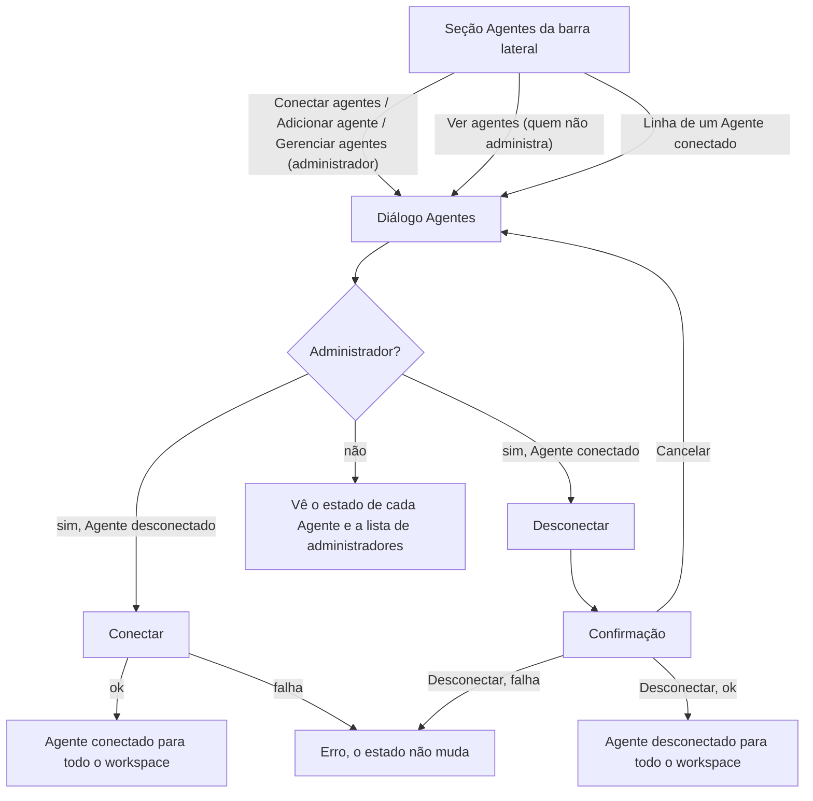

# PRD · F10 · Conexão de agentes

2026-11-11 · Luiz Carlos · Status: aprovado

## 1. Resumo executivo

- **Problema:** os agentes são a aposta do produto, mas hoje nenhum aparece no chat e ninguém pode
  decidir quais o workspace usa. Sem um lugar para conectar e ver os agentes, nenhuma das
  capacidades deles (resumo, delegação, consulta a dados) tem por onde chegar às Pessoas. Também
  não existe o papel de administrador, que o brief exige para conectar e desconectar agentes.
- **Solução proposta:** quem opera a instalação dá o papel de administrador a uma Pessoa pelo
  comando de contas. O administrador conecta e desconecta cada Agente do workspace pelo diálogo
  "Agentes", e todo o workspace vê, em tempo real, os Agentes conectados na barra lateral e no
  autocompletar de Menção. Quem não administra vê os Agentes e a quem pedir uma conexão.
- **Critérios de sucesso:** esta funcionalidade não move sozinha nenhuma métrica do product brief
  (seção "Objetivos e métricas de sucesso"). Ela entrega o item 8 do "Escopo do MVP" do brief e a
  promessa "Agentes são plugins", cumpre a parte de administração de agentes do requisito
  "Permissão" e é a porta de entrada da métrica "Uso do agente", que as F11 a F14 movem: só um
  Agente conectado pode ser mencionado.

## 2. Experiência do usuário e funcionamento

### Personas

- **Administrador:** uma Pessoa do workspace com o papel de administrador. Decide quais Agentes o
  time usa, conecta e desconecta cada um.
- **Pessoa que não administra:** conversa em Canais e Conversas diretas, quer saber quais Agentes
  pode mencionar e, quando falta um, a quem pedir.
- **Quem opera a instalação:** cria as contas por script e passa a dar e tirar o papel de
  administrador pelo comando de contas, até a F16 trazer a tela de papéis.

### Regras desta funcionalidade

- Os Agentes disponíveis são os que a instalação traz. No MVP há um, o `@assistente`. Instalar um
  Agente novo é trabalho de quem opera a instalação, não de quem usa o chat.
- Cada Agente disponível está conectado ou desconectado do workspace inteiro. Não há conexão por
  Canal nem por Pessoa. Um Agente recém-instalado começa desconectado.
- Só um administrador conecta e desconecta. Quem não administra vê os Agentes e o estado de cada
  um, mas não muda nada.
- O papel de administrador é dado e tirado por quem opera a instalação, pelo comando de contas. O
  workspace pode ter zero, um ou vários administradores. Ganhar ou perder o papel vale na próxima
  ação, sem precisar sair e entrar de novo. Na tela, as ações de administrador aparecem ou somem na
  próxima carga da página, e o selo, na próxima vez que o Perfil é aberto.
- Conectar é imediato, sem confirmação. Desconectar pede confirmação, como no frame "Desconectar
  agente".
- Um Agente conectado aparece para todas as Pessoas na seção Agentes da barra lateral e no
  autocompletar de Menção, e a Menção a ele fica destacada na Mensagem. Na F10 ele ainda não
  responde: atender pedidos começa na F11.
- Um Agente desconectado some da barra lateral e do autocompletar. As Menções a ele, novas e
  antigas, viram texto comum, sem destaque, e voltam a ser destacadas se ele for conectado de novo.
  As Mensagens que ele já gravou continuam nas Conversas, e conectá-lo de novo não muda nada nelas.
- O `@usuário` de um Agente é único no workspace, como o de uma Pessoa: nenhuma Pessoa pode ter o
  `@usuário` de um Agente, conectado ou não.
- Conectar ou desconectar não manda Alerta nem Mensagem: a barra lateral e o diálogo "Agentes"
  mudam para todas as Pessoas, em todas as abas, sem recarregar a página.
- Se o Serviço de agentes estiver fora, o resto do chat funciona normalmente. O diálogo "Agentes"
  mostra o erro, e conectar ou desconectar falha sem mudar o estado.

### Fluxo

### Histórias de usuário

1. Como administrador, quero conectar um Agente ao workspace para que todo o time possa
   mencioná-lo nas Conversas.
2. Como administrador, quero desconectar um Agente para que ninguém mais consiga mencioná-lo,
   sem perder o que ele já escreveu.
3. Como pessoa que não administra, quero ver quais Agentes estão conectados e quem são os
   administradores para saber o que posso mencionar e a quem pedir um Agente.
4. Como pessoa do workspace, quero encontrar um Agente conectado no autocompletar de Menção para
   chamá-lo sem precisar decorar o `@usuário` dele.
5. Como quem opera a instalação, quero dar e tirar o papel de administrador pelo comando de contas
   para que o workspace tenha quem conecte os Agentes antes de existir a tela de papéis.
6. Como pessoa do workspace, quero ver no Perfil de alguém se é administrador para saber a quem
   pedir um Agente.

### Critérios de aceite

**Todas as histórias**

- As telas seguem o design system do projeto e os frames "Casca / Agentes" (Admin sem nenhum
  conectado, Admin com parte conectada, Admin com todos conectados, Quem não administra),
  "Diálogos / Agentes" (Carregando, Erro, Vazio, Admin sem conectados, Admin com conectado, Membro
  sem conectados, Membro com conectado, Membro sem administradores, Conectando), "Diálogos /
  Desconectar agente" (Padrão, Enviando) e "Painel de perfil / Selo de administrador" do Figma do
  projeto, nos temas claro e escuro, e atingem 100 na nota de Acessibilidade do Lighthouse nos
  dois temas.
- Antes da implementação, o Figma é conferido e completado onde faltar: o erro ao conectar e ao
  desconectar, a Menção a um Agente no autocompletar e destacada na Mensagem, e a seção Agentes da
  barra lateral com o Serviço de agentes fora. O frame "Painel de perfil / Selo de administrador" é
  alinhado aos frames "Casca / Agentes" na linha do Agente e na ação da seção.
- Tudo funciona só pelo teclado. O diálogo "Agentes" abre com o foco no primeiro controle, Esc o
  fecha e, ao fechar, o foco volta para onde estava. A confirmação de desconectar abre com o foco
  em "Cancelar".
- Uma mudança de conexão aparece para as outras Pessoas em até 1 s no p95, sem recarregar a
  página, em todas as abas abertas, na barra lateral, no diálogo "Agentes" aberto, no
  autocompletar de Menção e no destaque das Menções.

**História 1, conectar um Agente**

- Para o administrador, a seção Agentes mostra "Conectar agentes", com o número de Agentes
  desconectados, quando nenhum está conectado; os conectados e "Adicionar agente" quando parte
  está conectada; os conectados e "Gerenciar agentes" quando todos estão.
- O diálogo "Agentes" lista cada Agente disponível com nome, `@usuário` e descrição. O
  desconectado tem o botão "Conectar". Sem nenhum conectado, o diálogo mostra o aviso de "Admin sem
  conectados".
- "Conectar" passa o Agente para o estado "Conectando", não aceita um segundo clique e, ao
  terminar, o mostra como conectado, com o botão "Desconectar".
- Se a conexão falhar, o Agente continua desconectado e o administrador vê uma mensagem de erro.
- Dois administradores agindo ao mesmo tempo no mesmo Agente não deixam o estado inconsistente:
  vale a última ação, e os dois veem o mesmo estado.

**História 2, desconectar um Agente**

- "Desconectar" abre a confirmação "Desconectar <nome>?", que explica que ninguém mais vai
  conseguir mencionar o Agente, que as Mensagens dele continuam e que ele pode ser conectado de
  novo.
- "Cancelar" ou Esc fecham a confirmação sem mudar nada. "Desconectar" mostra o estado "Enviando"
  e, ao terminar, fecha a confirmação e mostra o Agente como desconectado no diálogo.
- Depois de desconectado, o Agente some da barra lateral e do autocompletar para todas as Pessoas,
  e as Menções a ele, novas e antigas, viram texto comum. As Mensagens que ele já gravou continuam visíveis,
  com o avatar e a marca de Agente.
- Se a desconexão falhar, o Agente continua conectado e o administrador vê uma mensagem de erro.

**História 3, ver os Agentes sem administrar**

- Para quem não administra, a seção Agentes mostra os Agentes conectados e "Ver agentes".
- O diálogo "Agentes" lista cada Agente com o estado ("Conectado" ou não), sem botões de conectar
  ou desconectar, e explica que só administradores conectam ou desconectam.
- Abaixo, a lista "Administradores" mostra cada administrador com avatar, Presença, nome,
  `@usuário` e cargo. Sem nenhum administrador, o diálogo diz para falar com quem opera a
  instalação, como em "Membro sem administradores".
- Clicar ou dar Enter num administrador da lista abre o Perfil dele.
- Clicar na linha de um Agente conectado na barra lateral abre o diálogo "Agentes", para qualquer
  Pessoa.

**História 4, mencionar um Agente conectado**

- Ao digitar `@` no composer, o autocompletar mostra os Agentes conectados junto com os Membros,
  com o avatar de Agente, e filtra pelo que se digita, como já faz com as Pessoas.
- A Menção a um Agente conectado fica destacada na Mensagem enviada, para todas as Pessoas.
  Clicar nela, ou dar Enter com o foco nela, abre o diálogo "Agentes".
- O autocompletar não mostra Agentes desconectados, e uma Menção digitada à mão a um Agente
  desconectado fica como texto comum.
- Mencionar um Agente não gera Notificação para ninguém e, na F10, não produz resposta.

**História 5, dar e tirar o papel de administrador**

- O comando de contas dá e tira o papel de administrador de uma Pessoa pelo e-mail ou pelo
  `@usuário`, e informa o resultado.
- Quem perde o papel deixa de ver "Conectar agentes", "Adicionar agente" e "Gerenciar agentes" na
  próxima carga da página, sem precisar sair e entrar. Uma tentativa de conectar ou desconectar
  feita antes disso, numa tela já aberta, é recusada com uma mensagem de erro.
- Quem ganha o papel passa a ver as ações de administrador da mesma forma, na próxima carga da
  página.

**História 6, ver o selo de administrador**

- O painel de perfil de um administrador mostra o selo "Administrador" abaixo do `@usuário`, como
  no frame "Painel de perfil / Selo de administrador", inclusive no próprio Perfil.
- Depois que o papel muda, o selo aparece ou some na próxima vez que o painel de perfil é aberto.

**Erros e Serviço de agentes fora**

- Se o Serviço de agentes não responder, o diálogo "Agentes" mostra o estado "Erro", com "Tentar de
  novo", e o resto do chat (Mensagens, Conversas, Notificações) continua funcionando.
- Com o Serviço de agentes fora, a seção Agentes da barra lateral continua visível e abre o
  diálogo, que mostra o erro.

### O que não é objetivo

- O Agente responder a uma Menção, perguntar ou executar qualquer pedido: começa na F11.
- Instalar, criar ou configurar um Agente pela interface (nome, descrição, instruções, modelo de
  IA).
- Conectar um Agente só a alguns Canais ou só para algumas Pessoas.
- Tela de papéis e permissões, e dar ou tirar o papel de administrador pela interface: F16.
- Conversa direta com um Agente: o pedido ao Agente é feito por Menção numa Conversa.
- Presença e Status de Agentes.
- Histórico de quem conectou ou desconectou cada Agente e quando.
- Alerta ou Mensagem automática quando um Agente é conectado ou desconectado.
- Pedido de conexão de um Agente feito pela interface por quem não administra: a pessoa fala com
  um administrador pela Conversa direta.

## 3. Requisitos do sistema de IA

- **O que o agente pode fazer:** na F10, nada. Conectar não faz o Agente ler Mensagens, chamar o
  modelo de IA nem gravar nas Conversas, e um Agente desconectado nunca é chamado. A descrição
  mostrada no diálogo "Agentes" é texto fixo da instalação, sem geração por IA.
- **Estratégia de avaliação:** não se aplica nesta funcionalidade. A avaliação do Agente começa
  com o primeiro pedido que ele atende, na F11.

## 4. Riscos de produto

| Risco | Mitigação |
| --- | --- |
| A Pessoa menciona o Agente conectado, nada acontece, e ela conclui que ele não funciona | Risco aceito enquanto a F11 não chega; a F11 é a próxima funcionalidade de agentes, e a descrição no diálogo é a mesma que a F11 cumpre |
| Ninguém consegue conectar um Agente porque o workspace não tem administrador | O diálogo diz, para quem não administra, que não há administrador e que deve falar com quem opera a instalação |
| Uma Pessoa perde o papel e continua conectando Agentes numa aba aberta | A permissão é conferida no servidor a cada ação, e as ações de administrador somem da tela na próxima carga da página |
| Um administrador desconecta o Agente por engano e o time perde o acesso no meio do trabalho | A confirmação explica o efeito, e conectar de novo é um clique, sem perder as Mensagens do Agente |
| Uma Pessoa com o `@usuário` igual ao de um Agente confunde a Menção | O `@usuário` de um Agente é reservado: nenhuma Pessoa pode tê-lo |
| O Serviço de agentes fora trava o chat | O chat não depende do Serviço de agentes: só o diálogo "Agentes" mostra o erro |
