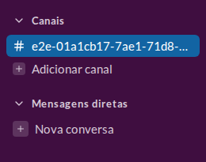
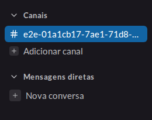
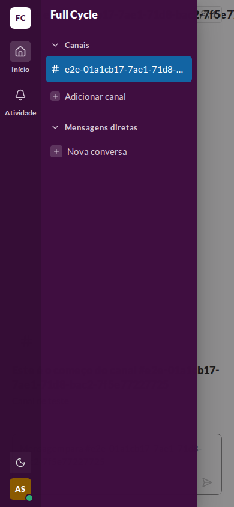
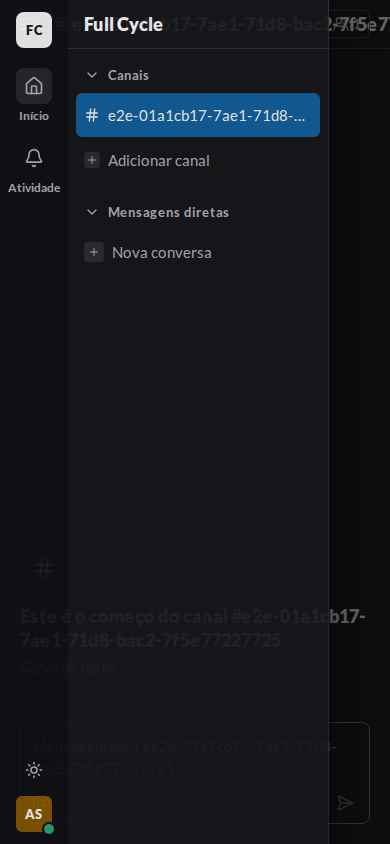
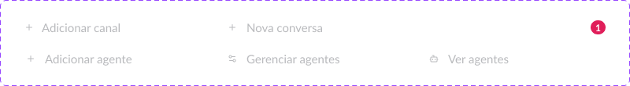

# Validação visual da F10-T01

Capturas da web no Chromium do contêiner `e2e`: a barra lateral em 1440 × 900 e a gaveta em
390 × 844, ao lado do component set SidebarAction (16:653) do Figma (arquivo `slack`, página
Components).

| Estado | Web, claro | Web, escuro |
| --- | --- | --- |
| Barra lateral com "Adicionar canal" e "Nova conversa" |  |  |
| Gaveta abaixo de 768 px |  |  |

Figma, SidebarAction com os seis modos: 

## O que bate

- "Adicionar canal" com o quadro de 16 px e "Nova conversa" com o de 20 px, os dois com o `plus` de
  12 px sobre `sidebar-field`, o rótulo em `body/regular` e `sidebar-fg`, como os modos
  `add-channel` e `new-dm` do Figma.
- A linha com `h-7` e raio `item` acima de 768 px, e 44 px na gaveta, igual a antes da refatoração.
- Os dois temas trocam só os tokens da barra lateral, sem diferença entre as ações.

## Diferenças esperadas

- Nenhuma. As variantes `connect`, `add`, `manage` e `view` entram na tela com a seção Agentes (05
  e 06), e a validação delas fica nessas tarefas.
