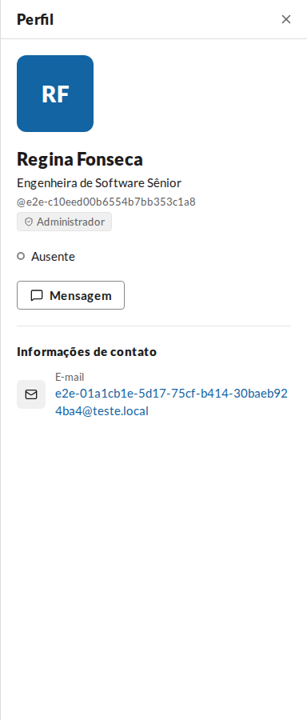
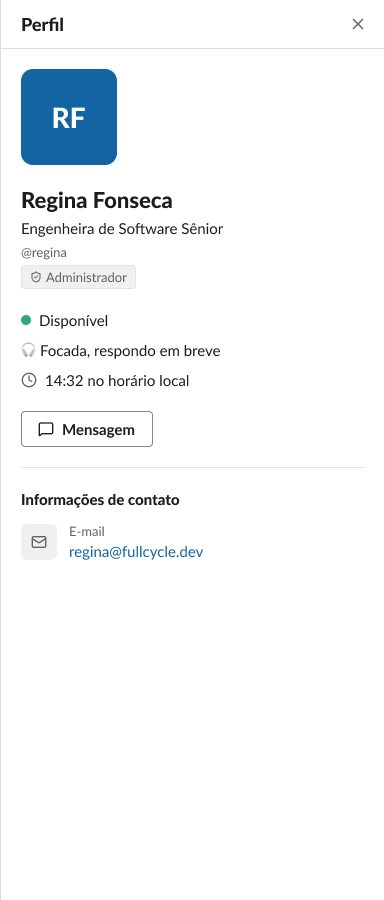
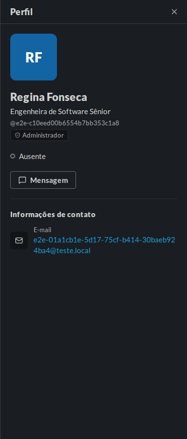
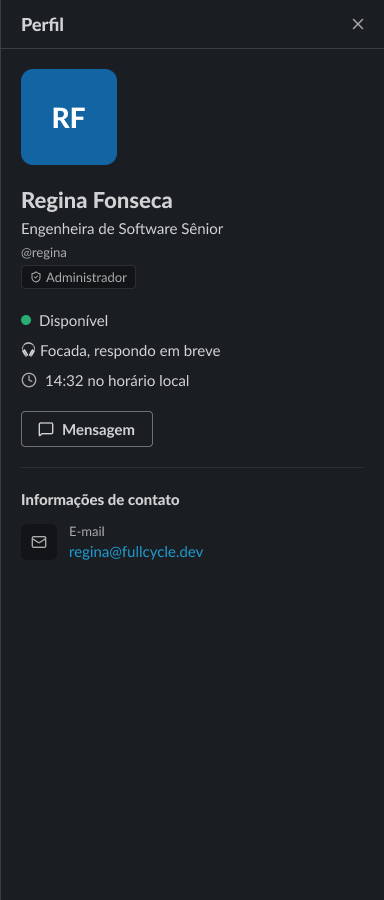

# Validação visual da F10-T02

Capturas da web em 1440 × 900, no Chromium do contêiner `e2e`, ao lado do ProfilePanel do frame
"Painel de perfil / Selo de administrador" (26:45404) do Figma (arquivo `slack`, página Telas). O
frame só existe no modo Light; a captura escura do Figma é o mesmo frame com o modo Dark da
coleção Semantic aplicado só para a captura, e desfeito depois.

| Estado | Web | Figma |
| --- | --- | --- |
| Painel com o selo, claro |  |  |
| Painel com o selo, escuro |  |  |

Tela inteira: [claro](capturas/painel-claro.png) e [escuro](capturas/painel-escuro.png).

## O que bate

- O selo logo abaixo do `@usuário`, na coluna de identidade com o `gap-1`: o escudo
  (`shield-check`) de 12 px e "Administrador" em `small/regular`, `fg-muted`, sobre
  `surface-inset`, com a borda `border-subtle`, o raio `control` e o respiro de 8 × 2 px.
- No escuro, os mesmos tokens trocam de valor, como no Figma com o modo Dark.

## Diferenças esperadas

- Os dados da Pessoa de teste: o `@usuário` e o e-mail gerados pelo teste, a Presença "Ausente"
  (a Pessoa não está conectada) e sem Status nem hora local, que o frame mostra preenchidos.
