# Validação visual da F10-T05

Capturas da web em 1440 × 900, no Chromium do contêiner `e2e`, como uma Pessoa que não administra,
ao lado dos frames do Figma (arquivo `slack`, página Telas, modo Light). Os estados de Erro, Vazio e
"Membro sem administradores" vêm com as rotas do BFF trocadas no navegador; a lista indisponível e
o Carregando, com o Uvicorn do Serviço de agentes parado.

## Seção Agentes

| Estado | Web, claro | Web, escuro | Figma |
| --- | --- | --- | --- |
| Com conectado |  | 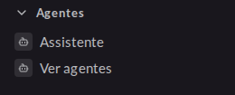 |  (Casca / Agentes / Quem não administra) |
| Sem conectado |  | 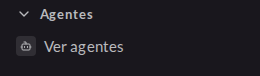 | — |
| Lista indisponível |  |  | 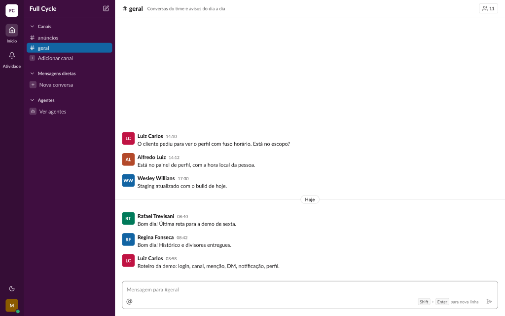 (Casca / Agentes / Lista indisponível, quem não administra) |

## Diálogo "Agentes"

| Estado | Web, claro | Web, escuro | Figma |
| --- | --- | --- | --- |
| Carregando | 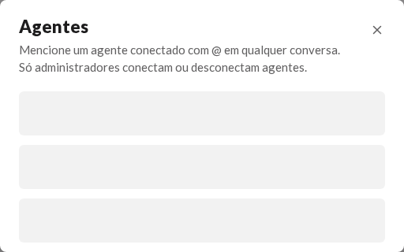 | 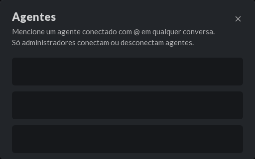 | 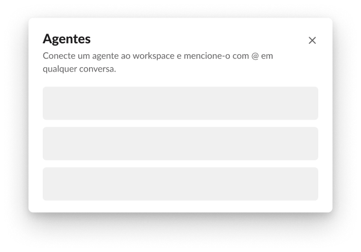 |
| Erro | 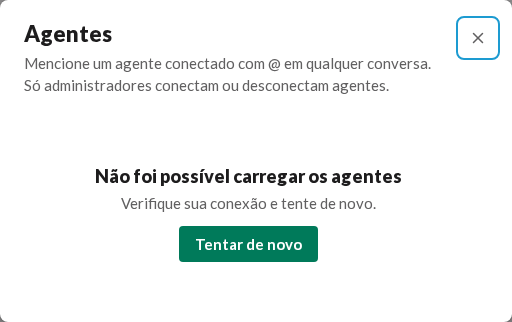 | 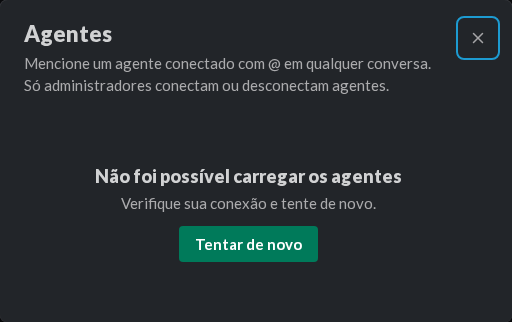 | 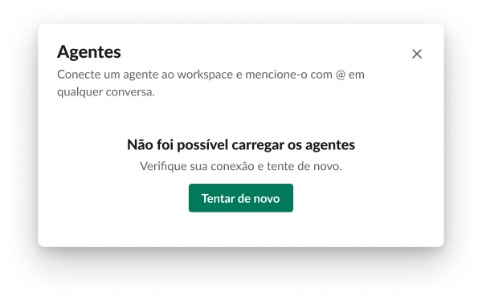 |
| Vazio | 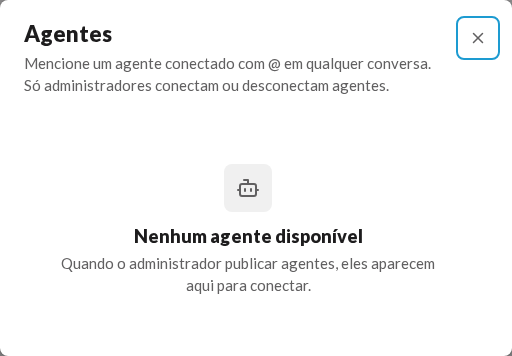 | 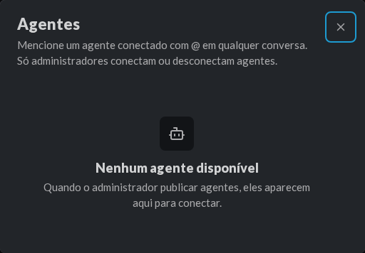 | 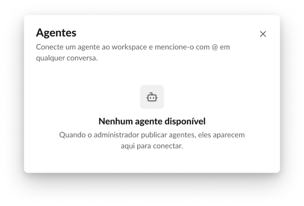 |
| Membro sem conectados | 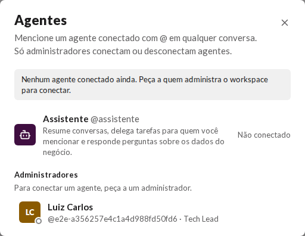 | 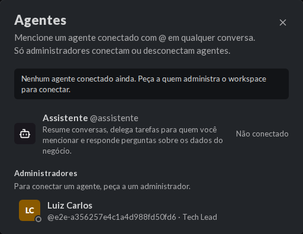 | 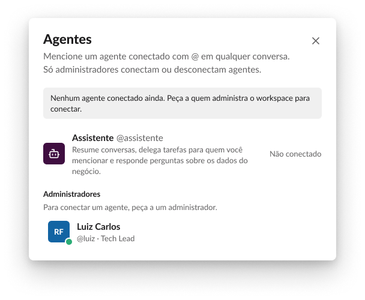 |
| Membro com conectado | 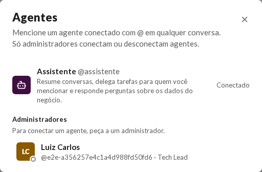 | 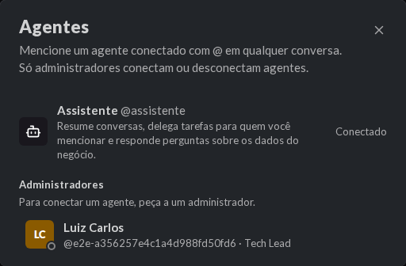 | 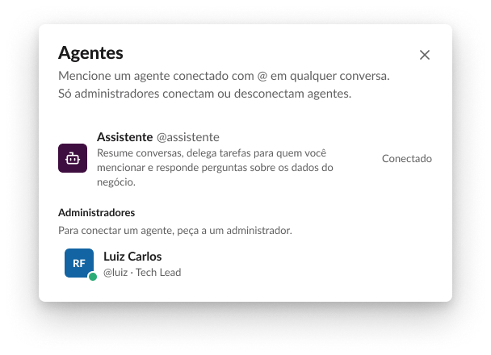 |
| Membro sem administradores | 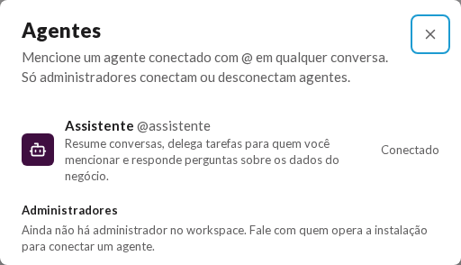 | 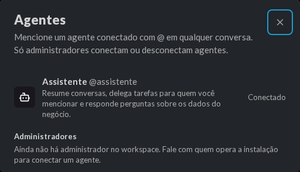 | 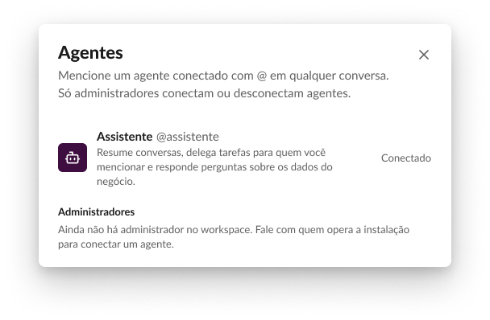 |

## Serviço de agentes fora

Com o Uvicorn parado, o layout carregou com a seção Agentes só com "Ver agentes", e
`GET /api/agents`, chamado da página logada, respondeu `502 {"kind":"agents_unavailable"}`
(F10-T05, CA3).

## O que bate

- A seção depois de "Mensagens diretas", com a linha do Agente (AgentAvatar de 20 sobre
  `sidebar-field` e o nome) e o SidebarAction `view`.
- O AgentRow do diálogo: AgentAvatar de 36 sobre `sidebar`, o nome em `body/bold` com o
  `@usuário` em `fg-muted`, a descrição em `small/regular` e o estado à direita.
- O aviso de "Membro sem conectados" em `surface-inset`, raio `item`; "Administradores" em
  `small/bold`, a explicação embaixo e o PersonRow com a Presença.
- Erro e Vazio pelo EmptyState, com o ícone `bot` no Vazio e "Tentar de novo" no Erro.

## Diferenças esperadas

- A descrição do cabeçalho em Carregando, Erro e Vazio: os frames usam o texto de administrador
  ("Conecte um agente..."); para quem não administra, a web mostra o texto dele ("Mencione um agente
  conectado..."). A visão de administrador entra com a 06.
- Os dados: o administrador de teste, sem Presença conectada e com o `@usuário` gerado.
