# Validação visual da F10-T06

Capturas da web em 1440 × 900, no Chromium do contêiner `e2e`, como administrador, ao lado dos
frames do Figma (arquivo `slack`, página Telas, modo Light; os frames de erro novos têm a cópia
escura no próprio Figma). O "Conectando" vem com a Server Action segurada no navegador, e o erro
com ela respondendo 500.

| Estado | Web, claro | Web, escuro | Figma |
| --- | --- | --- | --- |
| Seção, nenhum conectado | 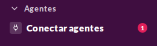 | 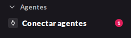 | 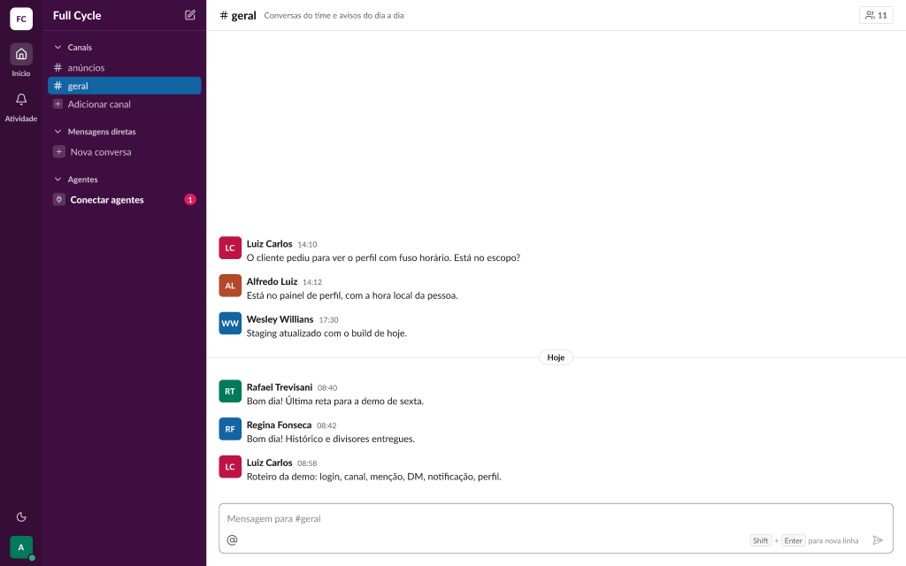 (Casca / Agentes / Admin sem nenhum conectado) |
| Seção, todos conectados | 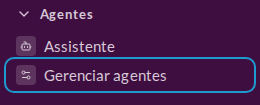 | 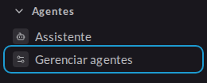 | 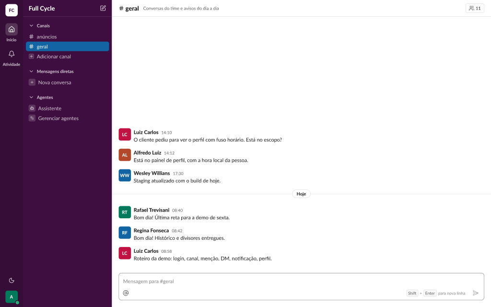 (Casca / Agentes / Admin com todos conectados) |
| Diálogo, Admin sem conectados | 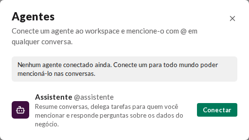 | 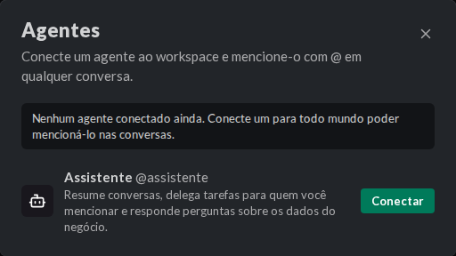 | 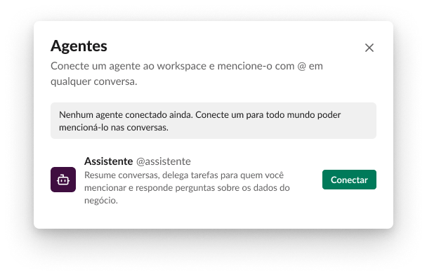 |
| Diálogo, Conectando | 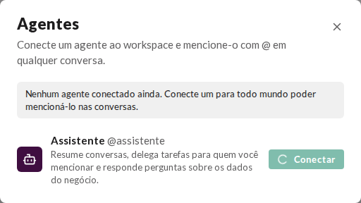 | 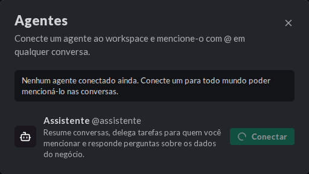 | 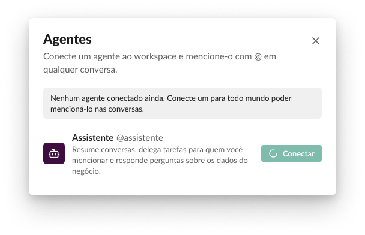 |
| Diálogo, Admin com conectado | 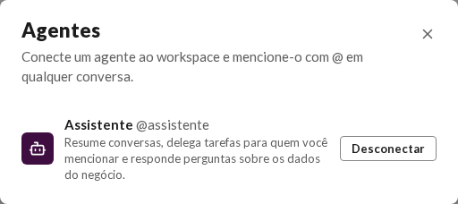 | 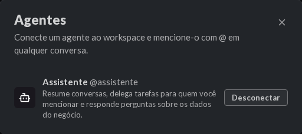 | 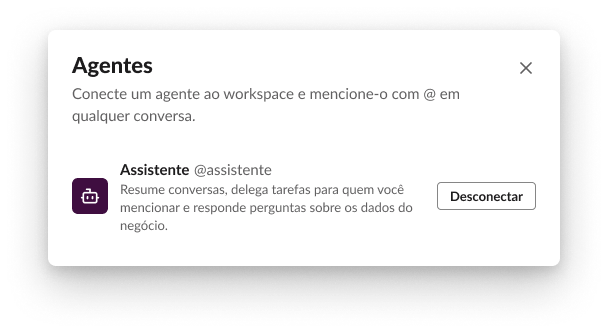 |
| Erro ao conectar | 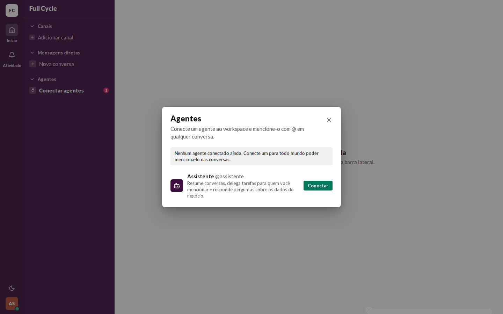 | 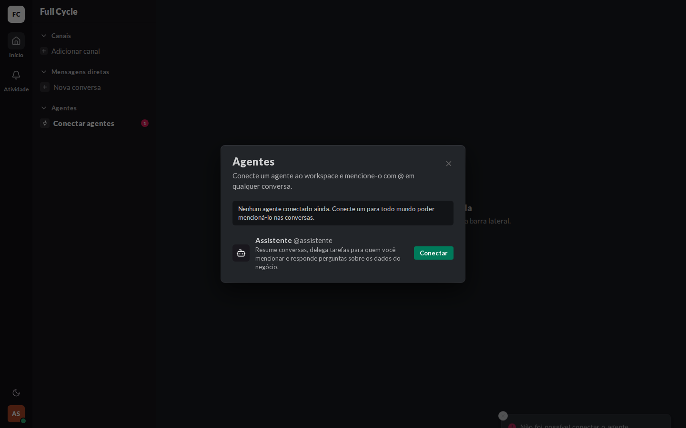 | 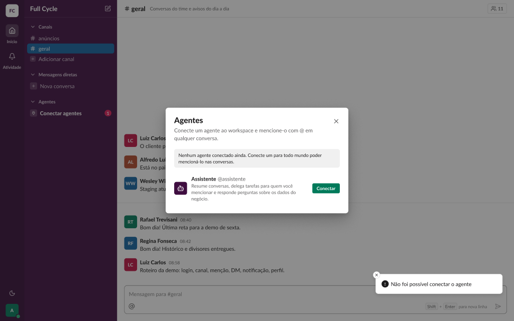 (Diálogos / Agentes / Erro ao conectar) |

## O que bate

- "Conectar agentes" em `font-black` e `sidebar-fg-strong`, com o `plug` e o CountBadge do número
  de desconectados; "Gerenciar agentes" com o `settings-2` e a linha do Agente.
- A descrição de administrador, o aviso de "Admin sem conectados", "Conectar" (Button `primary`,
  `sm`) e "Desconectar" (Button `secondary`, `sm`).
- "Conectando": o botão a 50% de opacidade, com o spinner no lugar do ícone e o texto mantido.
- O erro no Toast de erro do Sonner, no canto inferior direito, com o diálogo aberto e o Agente
  ainda desconectado.

## Diferenças esperadas

- "Admin com parte conectada" (25:22334) não aparece com um catálogo de um Agente só; a variante
  `add` é provada pelo Vitest (CA4).
