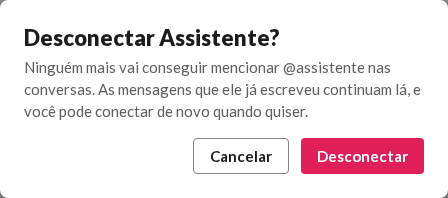
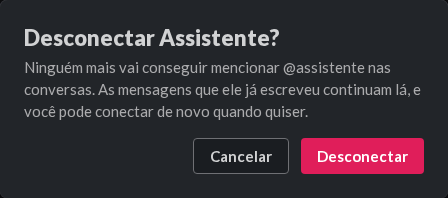
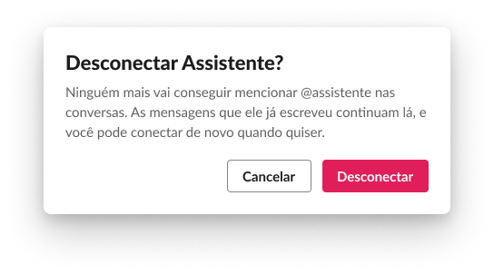
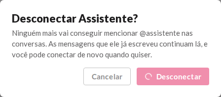
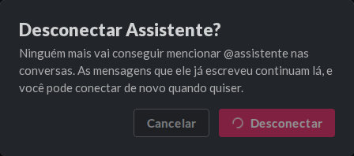
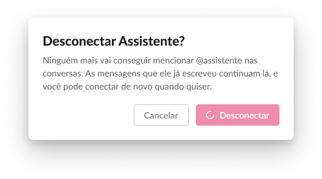
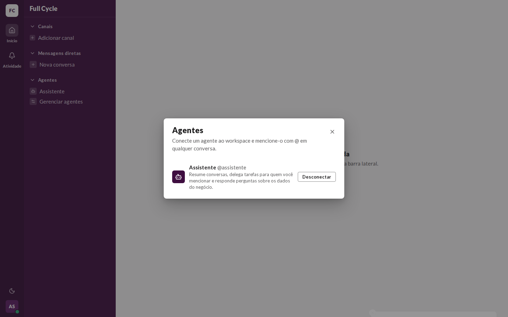
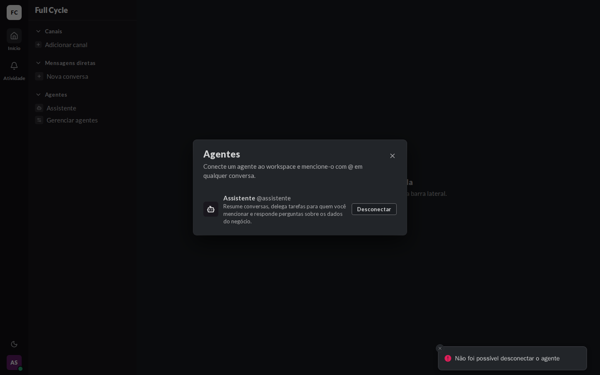
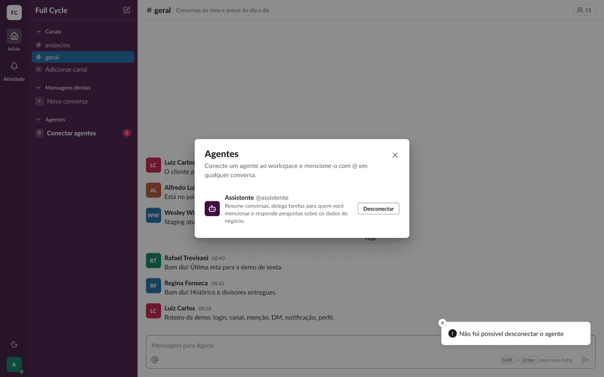

# Validação visual da F10-T07

Capturas da web em 1440 × 900, no Chromium do contêiner `e2e`, como administrador, ao lado dos
frames do Figma (arquivo `slack`, página Telas, modo Light; o frame de erro novo tem a cópia escura
no próprio Figma). O "Enviando" vem com a Server Action segurada no navegador, e o erro com ela
respondendo 500.

| Estado | Web, claro | Web, escuro | Figma |
| --- | --- | --- | --- |
| Confirmação, Padrão |  |  |  |
| Confirmação, Enviando |  |  |  |
| Erro ao desconectar |  |  |  (Diálogos / Desconectar agente / Erro ao desconectar) |

## O que bate

- O ConfirmDialog de 448: "Desconectar Assistente?" em `heading/black`, a descrição do frame com o
  `@usuário`, "Cancelar" (`secondary`, `md`) e "Desconectar" (`danger`, `md`).
- "Enviando": "Cancelar" desabilitado e "Desconectar" com o spinner, a 50% de opacidade.
- O erro: a confirmação fechada, o diálogo "Agentes" com o Agente ainda conectado e o Toast de erro
  no canto inferior direito.

## Diferenças esperadas

- Nenhuma.
