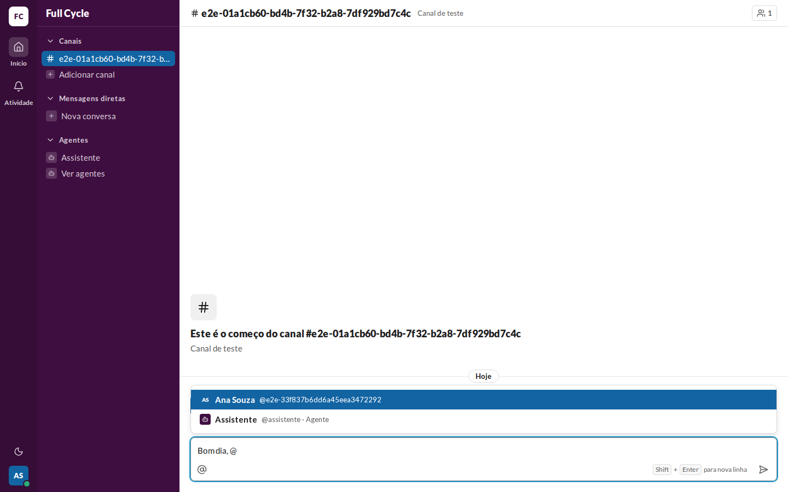
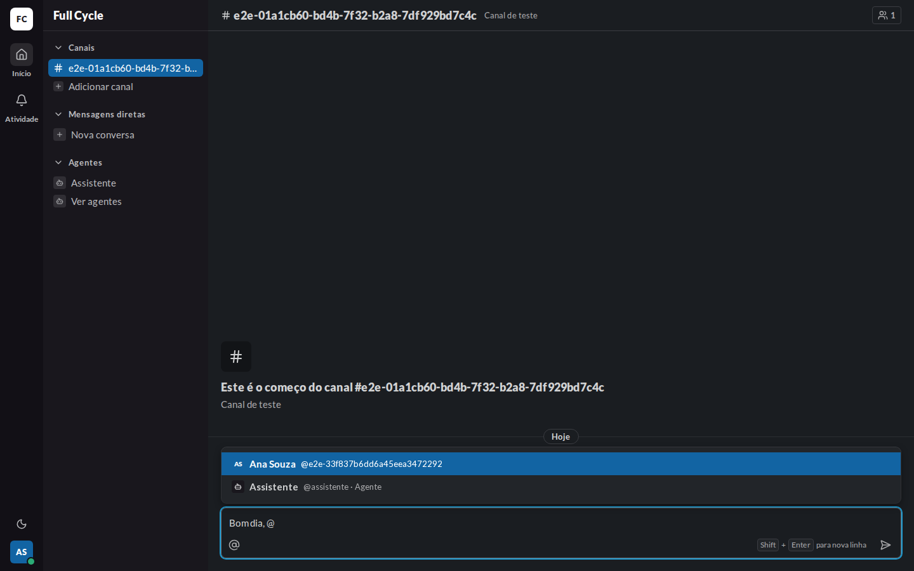
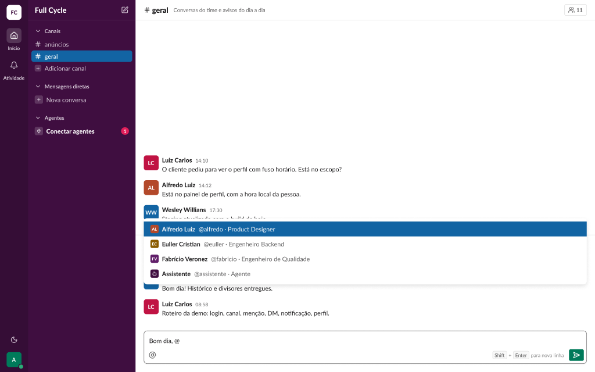
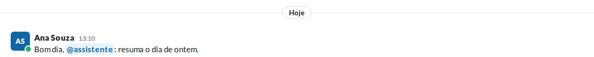
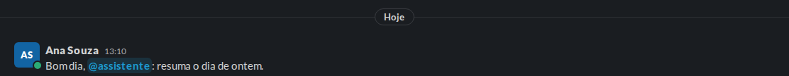
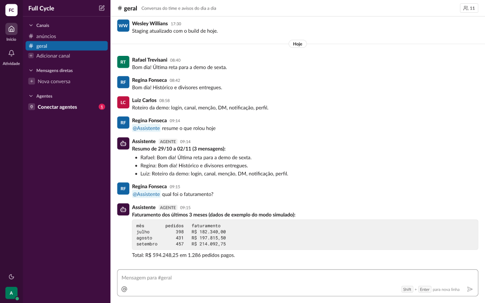

# Validação visual da F10-T09

Capturas da web em 1440 × 900, no Chromium do contêiner `e2e`, com o `assistente` conectado, ao
lado dos frames do Figma (arquivo `slack`, página Telas, modo Light; os frames novos têm a cópia
escura no próprio Figma).

| Estado | Web, claro | Web, escuro | Figma |
| --- | --- | --- | --- |
| Autocompletar com o Agente |  |  |  (Conversa / Composer / Lista de menções com Agente) |
| Mensagem com o chip |  |  |  (Conversa / Mensagem / Menção a Agente) |

## O que bate

- O Agente depois dos Membros, com o AgentAvatar `xs` sobre `sidebar`, o nome em `body/bold` e
  "@assistente · Agente" em `small`, `fg-muted` (ou `sidebar-on-active`, destacado).
- O `AgentMentionChip` em `mention-bg` e `mention-fg`, `font-bold` e raio `item`, como o
  MentionChip `Self=false` do frame.

## Diferenças esperadas

- Os dados: o Canal e a Pessoa do teste, em vez dos do frame.
