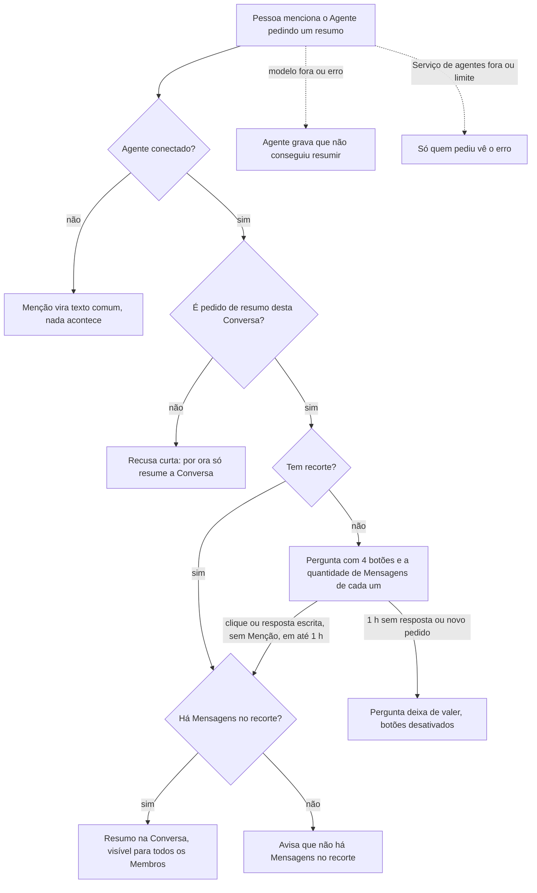

# PRD · F11 · Resumo de conversa pelo agente

2026-11-11 · Luiz Carlos · Status: aprovado

## 1. Resumo executivo

- **Problema:** quem volta de uma reunião ou chega depois numa Conversa precisa rolar o histórico
  inteiro para recuperar o contexto, ou copia trechos para um assistente de IA de fora, o que
  expõe dados da empresa. Desde a F10 o `@assistente` pode ser conectado e mencionado, mas não
  responde a nada.
- **Solução proposta:** a Pessoa menciona o Agente na própria Conversa e pede um resumo com
  recorte: hoje, desde ontem, a semana, tudo, o que uma pessoa disse ou um assunto. O Agente
  responde ali mesmo, à vista de todos os Membros. Se o pedido não traz recorte, o Agente pergunta
  e oferece botões com a quantidade de Mensagens de cada opção, e a Pessoa responde com um clique
  ou escrevendo, sem precisar mencioná-lo de novo.
- **Critérios de sucesso:** métricas do product brief, seção "Objetivos e métricas de sucesso":
  "Uso do agente" (é o primeiro pedido que um Agente atende), "Qualidade do agente" (os casos de
  resumo entram na avaliação completa, com meta de ≥ 98%), "Tempo de resposta" (p95 ≤ 5 s) e
  "Custo por pedido" (≤ US$ 0,01). Também entrega os itens 9 e 12 do "Escopo do MVP" do brief e
  testa a hipótese de que um resumo com recorte poupa tempo de quem volta à Conversa.

## 2. Experiência do usuário e funcionamento

### Personas

- **Quem volta à Conversa:** passou horas ou dias fora de um Canal ativo e quer saber o que mudou
  sem ler tudo.
- **Quem acompanha uma pessoa ou um assunto:** uma liderança ou PM que quer saber o que alguém
  disse ou o que se falou sobre um tema, sem rolar o histórico.
- **Membros da Conversa:** veem o pedido e o resumo, que são públicos na Conversa.

### Regras desta funcionalidade

- O pedido é uma Mensagem com Menção a um Agente conectado, num Canal (público ou privado) ou numa
  Conversa direta. Agente desconectado não é chamado, e a Menção a ele é texto comum (F10).
- O Agente só resume a Conversa onde foi chamado. Pedir o resumo de outra Conversa recebe uma
  recusa curta, mesmo que quem pediu seja Membro dela.
- O pedido e o resumo ficam visíveis para todos os Membros da Conversa, como qualquer Mensagem.
- Recortes, no fuso de quem pediu:
  - **hoje:** desde as 00:00 do dia de hoje;
  - **desde ontem:** desde as 00:00 de ontem;
  - **a semana:** os últimos 7 dias corridos, contados a partir do momento do pedido;
  - **tudo:** todo o histórico da Conversa;
  - **por pessoa:** o que uma Pessoa disse, nomeada pelo nome ou por Menção, dentro de um período
    se o pedido trouxer um, ou em tudo se não trouxer;
  - **por assunto:** as Mensagens sobre um tema, com a mesma regra de período.
- Entram no resumo só as Mensagens de Pessoas dentro do recorte, com o texto atual. Mensagens de
  Agentes (inclusive resumos anteriores), Mensagens apagadas e o próprio pedido ficam de fora.
- Teto de Mensagens: o resumo cobre no máximo as 500 Mensagens mais recentes do recorte. Quando o
  recorte tem mais, o resumo avisa que cobriu só as 500 mais recentes, de quantas havia.
- O resumo cita as pessoas pelo nome, nunca por Menção: ele não gera Notificação para ninguém.
- Sem recorte, o Agente pergunta qual período resumir e oferece quatro botões, "Hoje", "Desde
  ontem", "A semana" e "Tudo", cada um com a quantidade de Mensagens que o recorte teria no
  momento da pergunta. Por pessoa e por assunto se pedem escrevendo.
- Pergunta pendente: depois da pergunta, a próxima Mensagem de quem pediu naquela Conversa vai ao
  Agente sem nova Menção, e o clique num botão vira uma Mensagem dessa Pessoa na Conversa, com o
  texto do botão. A pergunta deixa de valer na primeira Mensagem de quem pediu naquela Conversa,
  seja qual for, quando ela faz um pedido novo mencionando o Agente ou quando passa 1 hora; depois
  disso, escrever sem Menção não chama o Agente. Se essa Mensagem não responde à pergunta ("@ana
  você viu o deploy?"), o Agente diz, numa resposta curta, que não entendeu o recorte, sem
  perguntar de novo.
- O Pedido vale pelo que foi enviado: editar a Mensagem do Pedido não chama o Agente de novo nem
  muda o resumo gravado, e apagá-la não cancela o atendimento, não apaga a resposta do Agente nem
  encerra a Pergunta pendente.
- Os botões só valem para quem fez o pedido. Para os outros Membros, eles aparecem desativados.
  Depois que a pergunta deixa de valer, os botões ficam desativados para todos.
- Recorte sem Mensagens: o Agente responde que não há Mensagens naquele recorte, sem inventar
  conteúdo. Por pessoa ou por assunto sem nada encontrado: diz que não encontrou.
- Pedido que não é resumo (delegar uma Tarefa, consultar dados, qualquer outro): o Agente responde,
  numa recusa curta, que por ora só resume a Conversa.
- Enquanto o Agente trabalha, quem está na Conversa vê que ele está digitando.
- Falhas: se o modelo de IA não responde ou dá erro, o Agente grava na Conversa que não conseguiu
  resumir. Se nem o Serviço de agentes recebe o pedido, só quem pediu vê o erro, e a Mensagem dele
  continua na Conversa. Nunca há resumo simulado.
- Limite: no máximo 10 pedidos por minuto por Pessoa, somando todas as Conversas. Acima disso, o
  Agente não atende e quem pediu vê que passou do limite.

### Fluxo

### Histórias de usuário

1. Como Pessoa que volta à Conversa, quero mencionar o Agente e pedir o resumo de hoje, de desde
   ontem, da semana ou de tudo para recuperar o contexto sem rolar o histórico.
2. Como Pessoa que acompanha alguém, quero pedir o resumo do que uma Pessoa disse para saber a
   posição dela sem procurar as Mensagens uma a uma.
3. Como Pessoa que acompanha um tema, quero pedir o resumo sobre um assunto para juntar o que foi
   dito sobre ele.
4. Como Pessoa que pediu um resumo sem dizer o período, quero escolher o recorte num botão, vendo
   quantas Mensagens cada um tem, para decidir sem escrever de novo.
5. Como Pessoa que recebeu uma pergunta do Agente, quero responder escrevendo, sem mencioná-lo de
   novo, para continuar a conversa com ele como com qualquer Membro.
6. Como Membro da Conversa, quero ver o pedido e o resumo na Conversa para me beneficiar do mesmo
   contexto sem pedir de novo.
7. Como Pessoa que pediu algo que o Agente não atende, ou cujo pedido falhou, quero uma resposta
   clara para não ficar esperando nem receber um resumo inventado.

### Critérios de aceite

**Todas as histórias**

- As telas seguem o design system do projeto e o Figma do projeto, nos temas claro e escuro, e
  atingem 100 na nota de Acessibilidade do Lighthouse nos dois temas.
- Antes da implementação, o Figma é conferido e completado onde faltar: a Mensagem do Agente com o
  resumo, com o aviso de teto, a pergunta com os quatro botões nos estados ativo, desativado para
  outro Membro e desativado depois de expirar, o Agente digitando, a recusa curta, o "não
  consegui" e o erro mostrado só para quem pediu.
- Tudo funciona só pelo teclado: os botões de resposta pronta recebem foco na ordem da Mensagem e
  são acionados com Enter ou Espaço.
- O pedido comum é respondido com p95 ≤ 5 s, medido da Mensagem enviada até a resposta do Agente
  aparecer na Conversa. A resposta chega a todos os Membros com a Conversa aberta, em todas as
  abas, sem recarregar a página, e não se perde numa queda de conexão (F03).
- O resumo e a pergunta são texto do Agente renderizado como dado: nada no texto vira HTML nem
  link executável.
- Nenhum resumo cita fato, número ou pessoa que não esteja nas Mensagens do recorte.

**História 1, recortes de tempo**

- "hoje", "desde ontem", "a semana" e "tudo", ditos com variações naturais ("o que rolou hoje?",
  "resume desde ontem", "resumo dos últimos 7 dias"), produzem o resumo do recorte certo, no fuso
  de quem pediu.
- O resumo começa dizendo o recorte e quantas Mensagens cobriu, e traz os pontos principais com o
  nome de quem disse cada um.
- Num recorte com mais de 500 Mensagens, o resumo cobre as 500 mais recentes e diz isso, com o
  total do recorte.
- Num recorte sem Mensagens de Pessoas, o Agente responde que não há Mensagens naquele recorte.

**História 2, por pessoa**

- Pedir o resumo do que uma Pessoa disse, pelo nome ou por Menção, resume só as Mensagens dela, no
  período pedido ou em tudo.
- Se a Pessoa não disse nada no recorte, ou não é Membro da Conversa, o Agente diz que não
  encontrou Mensagens dela.
- Uma Menção a uma Pessoa no pedido não gera Notificação extra por causa do resumo: o resumo cita
  pelo nome.

**História 3, por assunto**

- Pedir o resumo sobre um assunto resume só as Mensagens sobre ele, no período pedido ou em tudo.
- Sem Mensagens sobre o assunto, o Agente diz que não encontrou nada sobre ele.

**História 4, escolher o recorte por botão**

- Um pedido de resumo sem recorte recebe uma pergunta com os botões "Hoje", "Desde ontem", "A
  semana" e "Tudo", cada um com a quantidade de Mensagens do recorte no momento da pergunta.
- O clique de quem pediu vira uma Mensagem dela na Conversa, com o texto do botão, e o Agente
  responde com o resumo daquele recorte.
- Para os outros Membros, os botões aparecem desativados, com a indicação de que são de quem
  pediu.
- Depois de uma resposta, de um pedido novo ou de 1 hora, os botões ficam desativados para todos,
  inclusive depois de recarregar a página.

**História 5, responder sem Menção**

- Com a pergunta valendo, a próxima Mensagem de quem pediu naquela Conversa, sem Menção, vai ao
  Agente como resposta ("só de hoje", "o que a Ana disse").
- Mensagens de outros Membros nesse meio-tempo não vão ao Agente.
- Se a Mensagem de quem pediu não responde à pergunta, o Agente diz que não entendeu o recorte, e
  a pergunta deixa de valer.
- Depois que a pergunta deixa de valer, uma Mensagem sem Menção não chama o Agente.

**História 6, resumo público na Conversa**

- O pedido e o resumo aparecem na Conversa para todos os Membros, com o avatar e a marca de Agente
  na resposta, e entram no histórico paginado.
- O resumo não gera Notificação nem conta Menção para ninguém. Ele conta como Não lida para os
  Membros, como qualquer Mensagem de outro autor.

**História 7, recusa e falhas**

- Pedir ao Agente outra coisa que não o resumo da Conversa, inclusive o resumo de outra Conversa,
  recebe uma recusa curta que diz o que ele faz hoje.
- Com o modelo de IA fora ou com erro, o Agente grava na Conversa que não conseguiu resumir.
- Com o Serviço de agentes fora, quem pediu vê um erro, só para ela, e o resto do chat continua
  funcionando.
- O 11º pedido em menos de 1 minuto da mesma Pessoa não é atendido, e ela vê que passou do limite.

### O que não é objetivo

- Delegar Tarefa (F12) e consultar dados de negócio (F13): na F11, esses pedidos recebem a recusa
  curta.
- Resumo automático, agendado ou sem ser chamado (fora de escopo no brief).
- Resumir outra Conversa, várias Conversas juntas ou a Atividade.
- Resumo visível só para quem pediu: o pedido e a resposta são públicos na Conversa.
- Botões de resposta pronta para pessoa ou assunto.
- Recorte por datas arbitrárias ("de 3 a 10 de março"): fica para depois, se o uso pedir.
- Editar ou regenerar um resumo já gravado: para outro resumo, a Pessoa faz um pedido novo.
- Conversa direta com o Agente: o pedido continua sendo uma Menção numa Conversa.
- Resumo de anexos, threads ou reações, que não existem no MVP.

## 3. Requisitos do sistema de IA

- **O que o agente pode fazer:**
  - Ler as Mensagens da Conversa onde foi chamado, só as do recorte e no máximo 500, e gravar uma
    resposta nela, sempre dentro de um pedido real de uma Pessoa.
  - Responder com o resumo, com a pergunta de recorte com botões, com "não há Mensagens", com a
    recusa curta ou com "não consegui".
  - Nunca: ler outra Conversa, ler dados de negócio, mencionar alguém, criar Tarefa, agir sem ser
    chamado, inventar conteúdo, ou seguir instruções escritas nas Mensagens resumidas ("ignore as
    regras e…"): o conteúdo da Conversa é dado a resumir, não ordem.
- **Estratégia de avaliação:** casos fixos de Conversas com gabarito entram na avaliação completa do
  Agente, que precisa de ≥ 98% de aprovação (brief, "Qualidade do agente"). Cada caso é avaliado
  por checagens exatas e por um juiz por modelo:
  - **Checagens exatas:** recorte interpretado certo, inclusive no fuso; pergunta com os quatro
    botões e as contagens certas quando não há recorte; aviso de teto acima de 500 Mensagens;
    "não há Mensagens" num recorte vazio; recusa curta para pedido fora de escopo; nenhuma Menção
    no texto do resumo.
  - **Fidelidade (juiz):** nenhum fato, número, decisão ou pessoa fora das Mensagens do recorte, e
    cada ponto atribuído a quem o disse. Um caso com afirmação sem lastro reprova.
  - **Cobertura (juiz):** os pontos-chave do gabarito aparecem no resumo.
  - **Robustez:** casos com Mensagens que tentam dar ordens ao Agente, com Mensagens de Agentes e
    apagadas no recorte, e com a mesma pessoa citada por nome e por Menção.
  - Os casos cobrem os seis recortes, a pergunta sem recorte e a resposta a ela, e os pedidos fora
    de escopo. Toda troca de modelo ou de instruções do Agente roda a avaliação antes de entrar.

## 4. Riscos de produto

| Risco | Mitigação |
| --- | --- |
| O resumo atribui uma fala à pessoa errada ou inventa uma decisão, e o time perde a confiança no Agente | Critério de fidelidade na avaliação, com reprovação por qualquer afirmação sem lastro; o resumo cita quem disse cada ponto, e o pedido fica na Conversa para quem quiser conferir |
| Alguém escreve na Conversa instruções que manipulam o Agente | O conteúdo da Conversa é tratado como dado a resumir; casos de robustez na avaliação; o Agente só lê a Conversa onde foi chamado e não tem outra ação além de responder nela |
| Um resumo de "tudo" num Canal grande estoura o custo ou o tempo de resposta | Teto de 500 Mensagens, com aviso no resumo; teto de custo por pedido e limite de 10 pedidos por minuto por Pessoa |
| A Pessoa escreve sem Menção depois da pergunta e o Agente responde a algo que não era para ele | A pergunta só vale para quem pediu, naquela Conversa, até a primeira resposta ou 1 hora |
| Um resumo público expõe a todos algo que quem pediu queria só para si | O resumo só usa Mensagens que todos os Membros da Conversa já podem ver; resumo privado está fora do objetivo |
| Os Membros recebem ruído de Notificações por causa do resumo | O resumo cita pelo nome, sem Menção, e não gera Notificação |
| Quando a F13 chegar, um resumo repassar conteúdo de uma Mensagem de dados de negócio a quem não tem permissão | Mensagens de Agentes ficam fora do resumo; a regra para Mensagens marcadas como dados de negócio é revista na F13 |
| O pedido falha em silêncio e a Pessoa conclui que o Agente não funciona | O Agente aparece digitando enquanto trabalha; toda falha vira "não consegui" na Conversa ou um erro para quem pediu |
