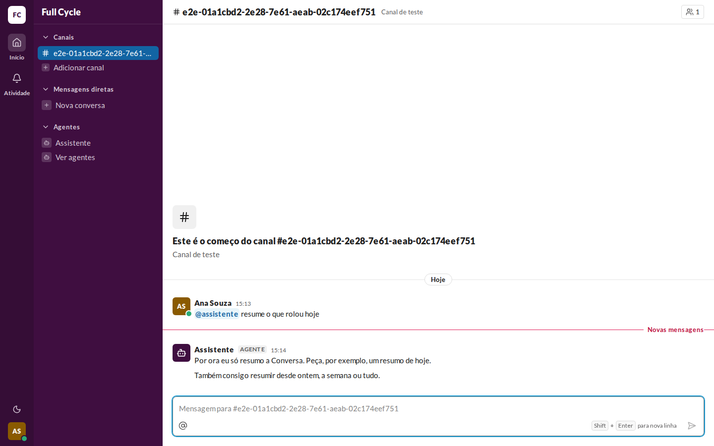
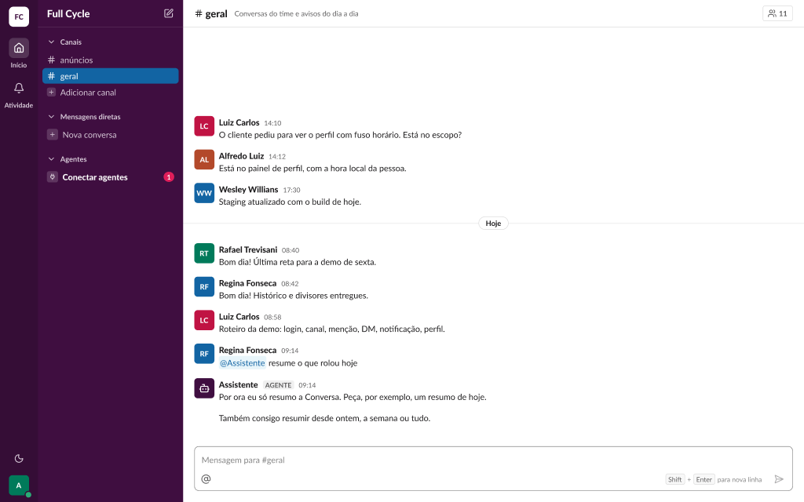
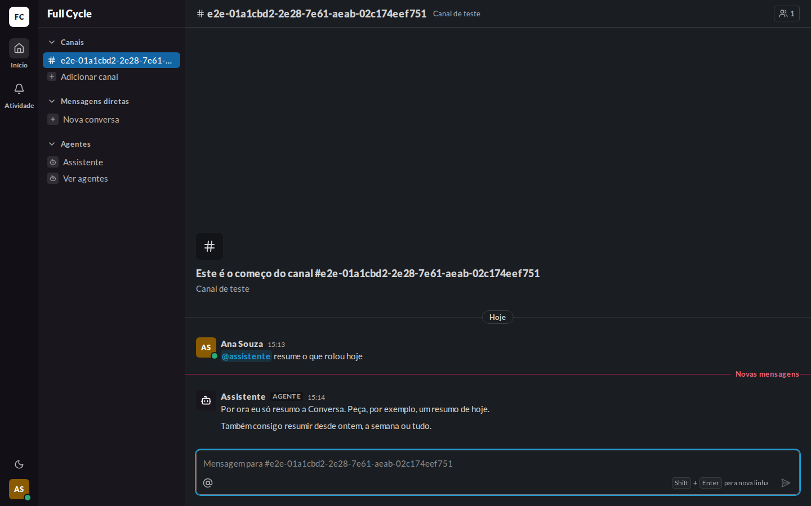
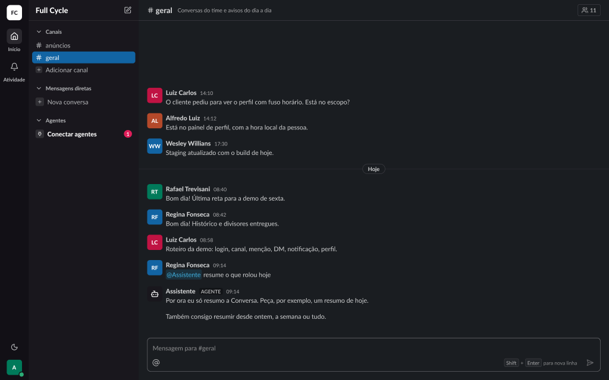

# Validação visual da F11-T01

Capturas da web em 1440 × 900, no Chromium do contêiner `e2e`, com uma Mensagem de Pessoa e duas
Mensagens seguidas de um bot "Assistente" (a completa e a compacta), ao lado dos frames do Figma
(arquivo `slack`, página Telas, seção "Conversa").

| Estado | Web | Figma |
| --- | --- | --- |
| Mensagem do Agente, claro |  |  (Conversa / Mensagem / Mensagem do Agente) |
| Mensagem do Agente, escuro |  |  (Conversa / Mensagem / Mensagem do Agente (escuro)) |

## O que bate

- A forma completa: o AgentAvatar `md` sobre `sidebar`, o nome em `body`, `font-black`, o AgentTag
  "AGENTE" (`caption/bold`, `fg-muted` sobre `surface-inset`, raio `control`, 4 px nas laterais) e
  a hora em `caption`, `fg-muted`, sem o Status.
- A forma compacta logo abaixo, sem avatar nem nome, alinhada ao texto da completa.
- Os dois temas pelas variables `Semantic`.

## Diferenças esperadas

- Os dados: o Canal, a Pessoa e as horas do teste, em vez dos do frame.
- O divisor "Novas mensagens" da web, porque as Mensagens de bot são Não lidas para a Pessoa do
  teste (spec da F11, "Autor da Mensagem").
