# Validação visual da F11-T04

Capturas da web em 1440 × 900, no Chromium do contêiner `e2e`, com a Mensagem de uma Pessoa pedindo
ao Assistente e a Mensagem do Agente gravada direto no banco, ao lado dos frames do Figma (arquivo
`slack`, página Telas, seção "Conversa").

| Estado | Web | Figma |
| --- | --- | --- |
| Resumo, claro | 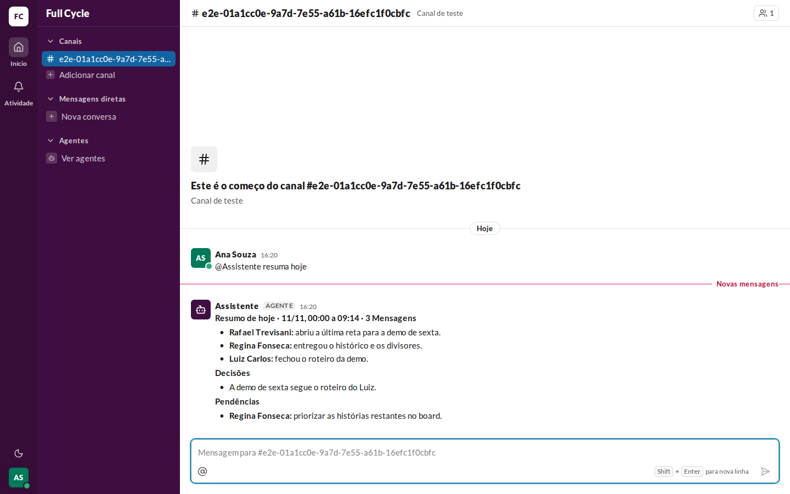 | 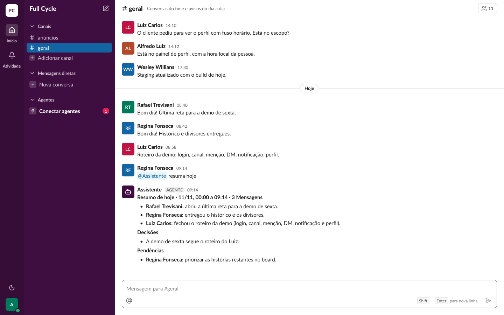 (Conversa / Mensagem / Resumo do agente) |
| Resumo, escuro | 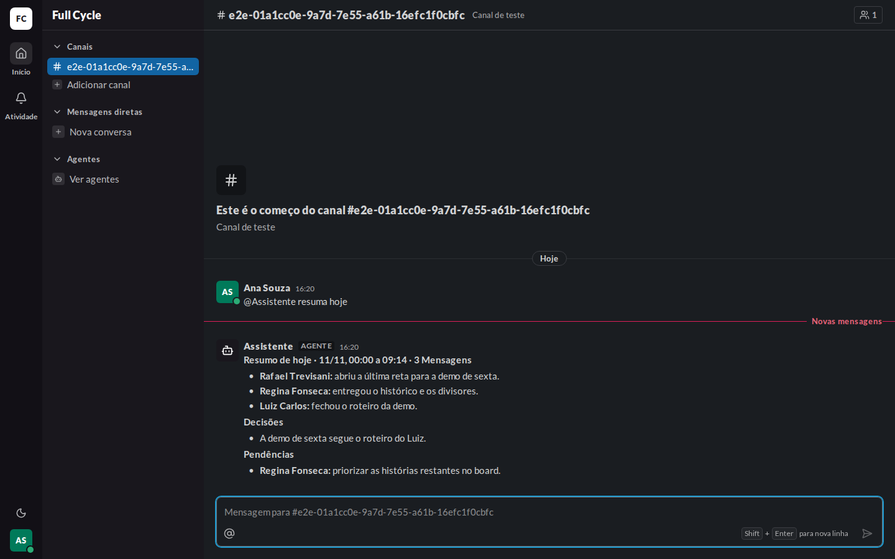 | 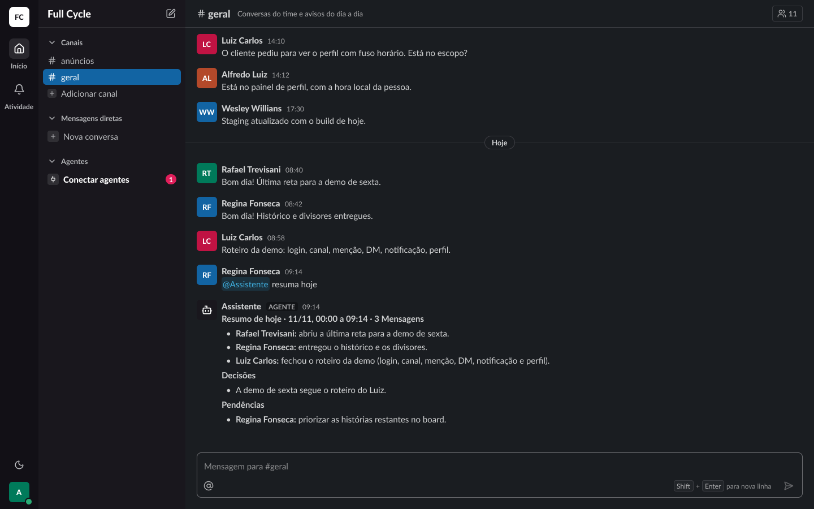 (Conversa / Mensagem / Resumo do agente (escuro)) |
| Aviso de teto, claro | 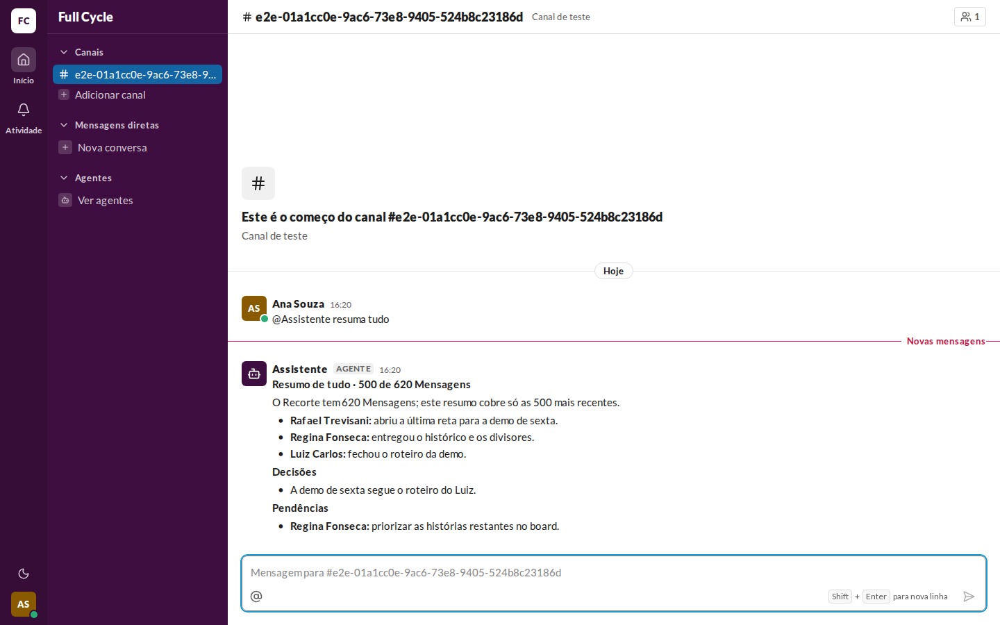 | 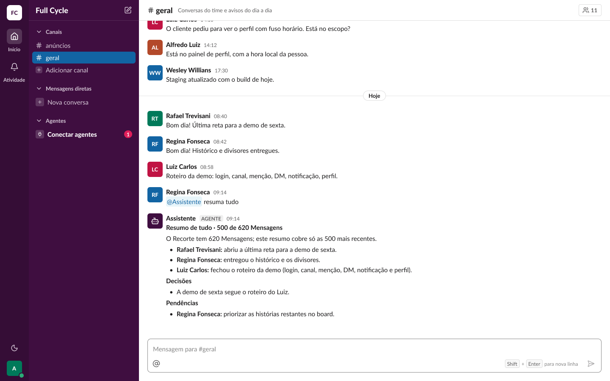 (Conversa / Mensagem / Resumo do agente com aviso de teto) |
| Aviso de teto, escuro | 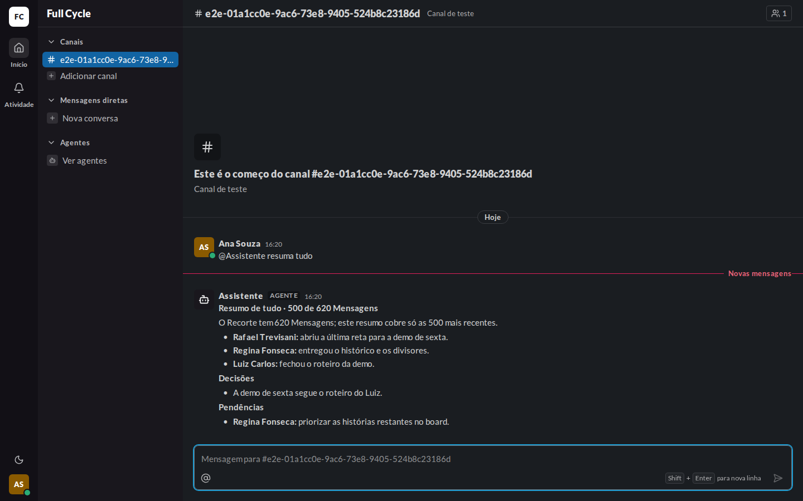 | 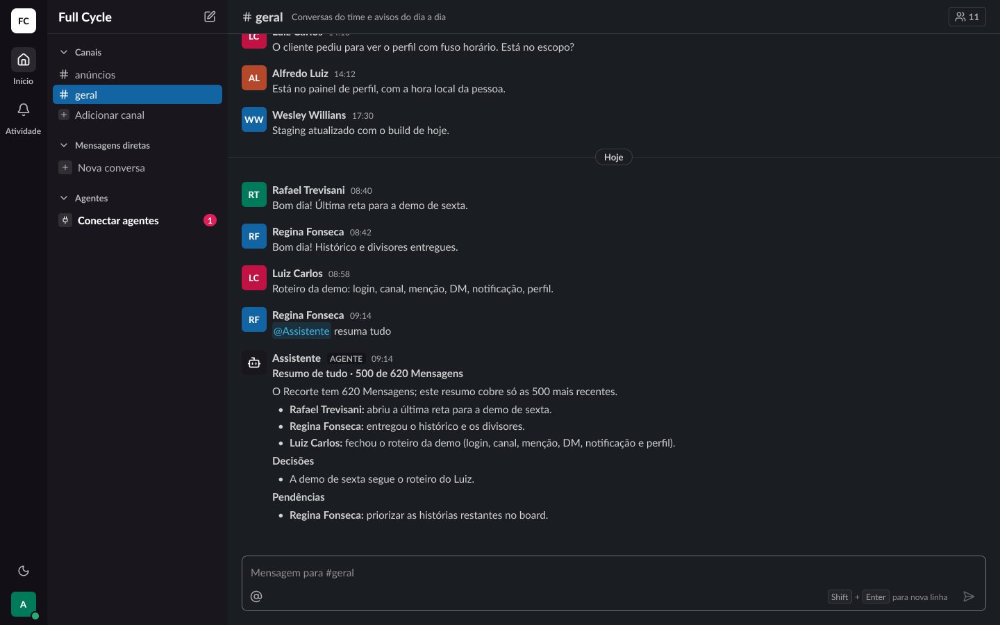 (Conversa / Mensagem / Resumo do agente com aviso de teto (escuro)) |
| Recusa, claro | 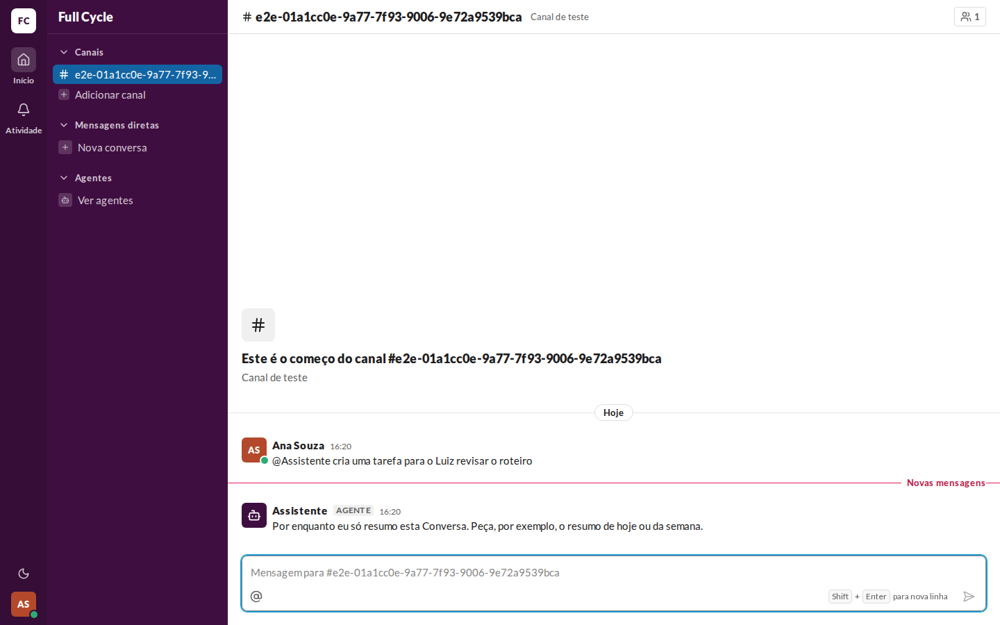 | 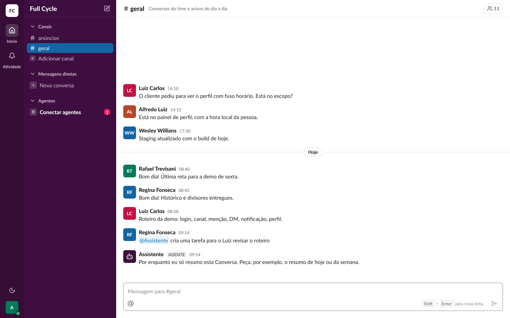 (Conversa / Mensagem / Recusa do agente) |
| Recusa, escuro | 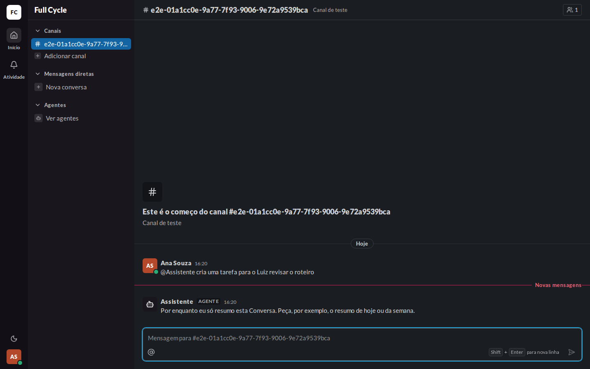 | 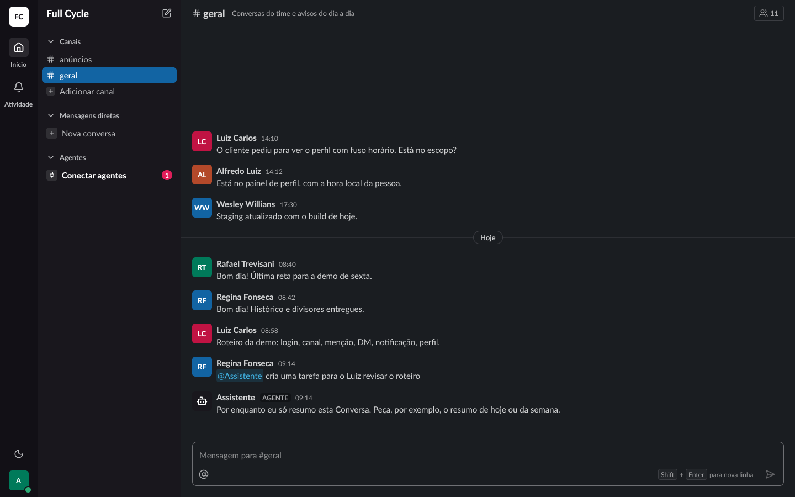 (Conversa / Mensagem / Recusa do agente (escuro)) |

## O que bate

- O AgentText (153:44412): o cabeçalho em `body/bold`, os parágrafos em `body/regular`, `space/1`
  entre os blocos, a lista com o marcador "•" a `space/2` do texto, `space/0-5` entre os itens e
  `space/2` de recuo, tudo em `text/fg`.
- O nome de quem disse em negrito no começo de cada item, e o aviso de teto como parágrafo logo
  abaixo do cabeçalho.
- A recusa como um parágrafo só.
- Os dois temas pelas variables `Semantic`.

## Diferenças esperadas

- Os dados: o Canal, a Pessoa e as horas do teste, em vez dos do frame, e só duas Mensagens no
  histórico.
- O divisor "Novas mensagens" da web, porque a Mensagem do bot é Não lida para a Pessoa do teste
  (spec da F11, "Autor da Mensagem").
- A Menção ao Assistente aparece como texto na web porque a Mensagem foi gravada direto no banco,
  sem o Agente conectado; o chip é da F10 e não muda nesta tarefa.
