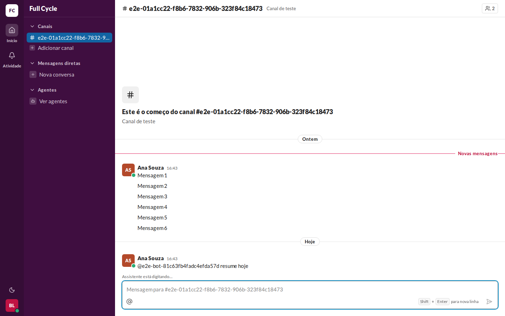
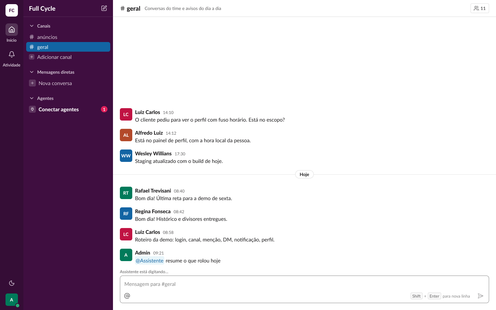
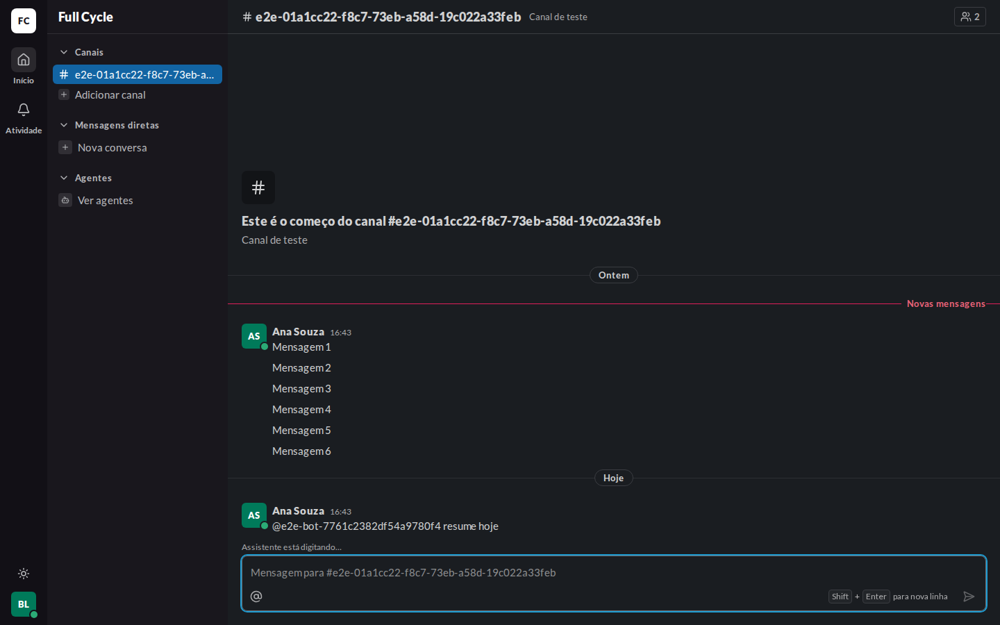
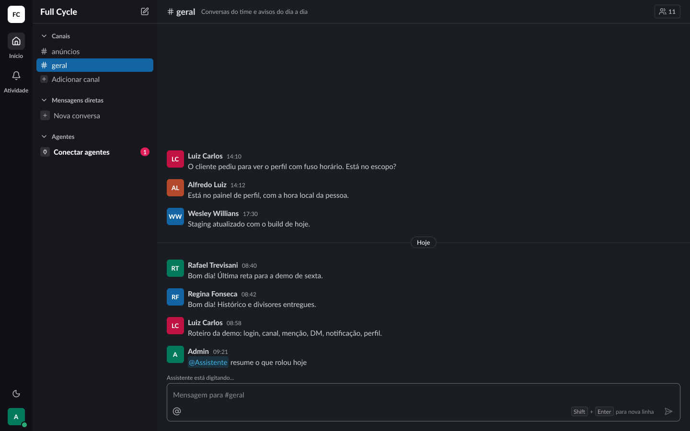

# Validação visual da F11-T05

Capturas da web em 1440 × 900, no Chromium do contêiner `e2e`, na aba do Bruno, com a Mensagem da
Ana que criou o Pedido e o bot do teste avisando que digita pela rota `/v1/bot`, ao lado dos frames
do Figma (arquivo `slack`, página Telas, seção "Conversa").

| Estado | Web | Figma |
| --- | --- | --- |
| Agente digitando, claro |  |  (Conversa / Lista / Agente digitando) |
| Agente digitando, escuro |  |  (Conversa / Lista / Agente digitando (escuro)) |

## O que bate

- A linha do "digitando" acima da caixa de mensagem, com a mesma altura com ou sem texto, em
  `caption` e `text/fg-muted`, com "Assistente está digitando…": o nome do Agente vem do `author`
  do evento.
- O mesmo componente e o mesmo texto do "digitando" de Pessoa (Conversa / Lista / Digitando).
- Os dois temas pelas variables `Semantic`.

## Diferenças esperadas

- Os dados: o Canal, as Pessoas e as horas do teste, em vez dos do frame, e o histórico curto.
- A Menção ao bot aparece como texto na web porque o bot do teste tem `@usuário` aleatório e não é
  um Agente do registro; o chip é da F10 e não muda nesta tarefa.
- O divisor "Novas mensagens" da web, porque as Mensagens da Ana são Não lidas para o Bruno.
