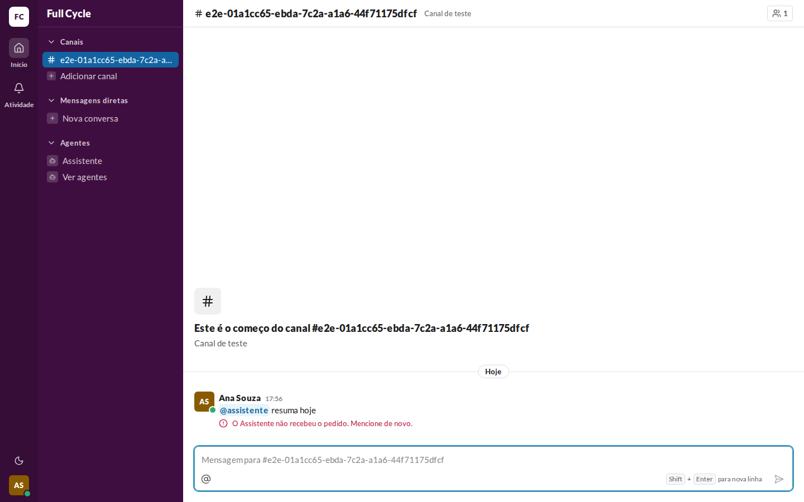
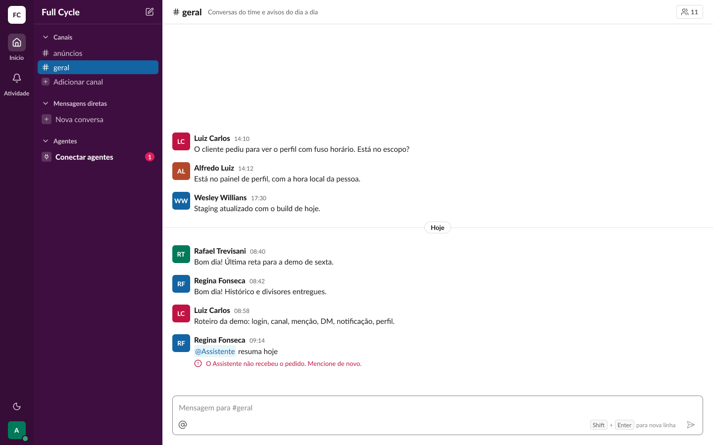
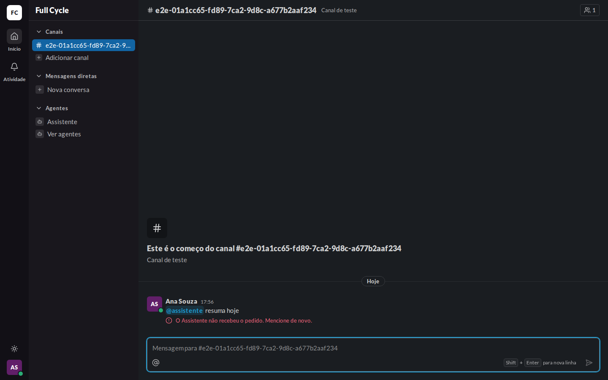
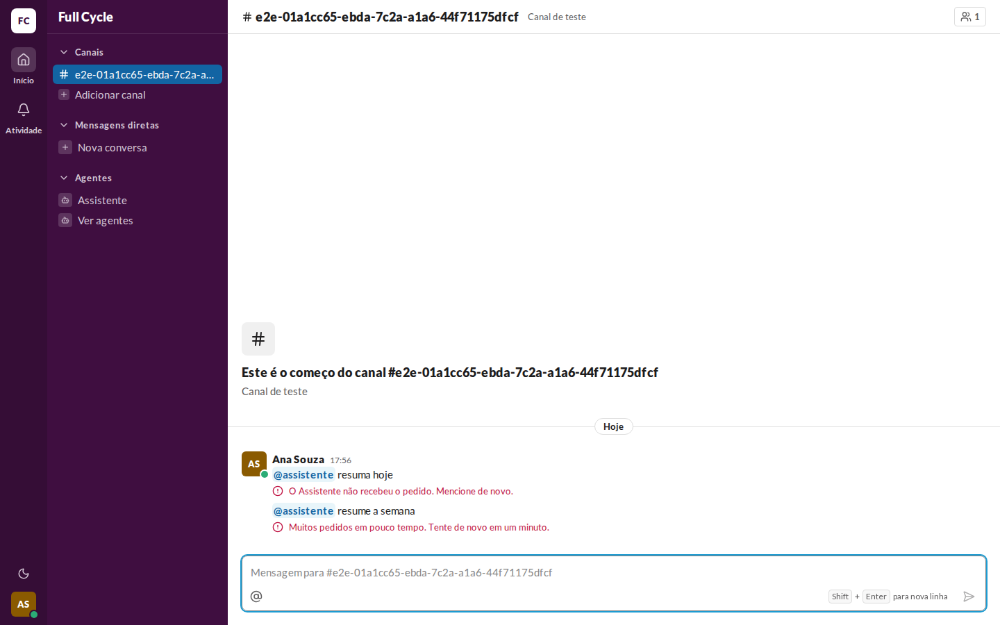
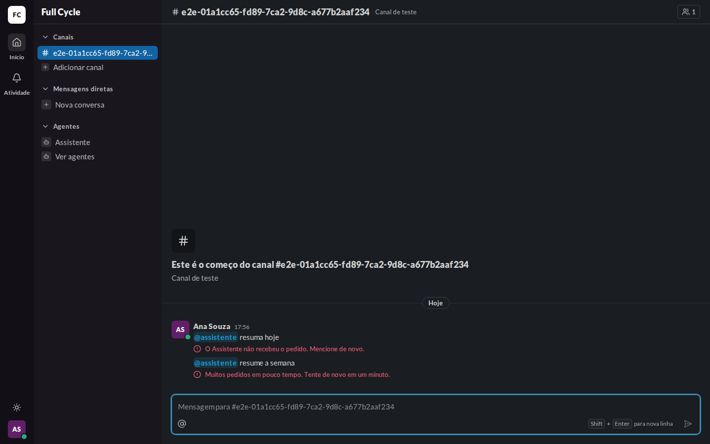
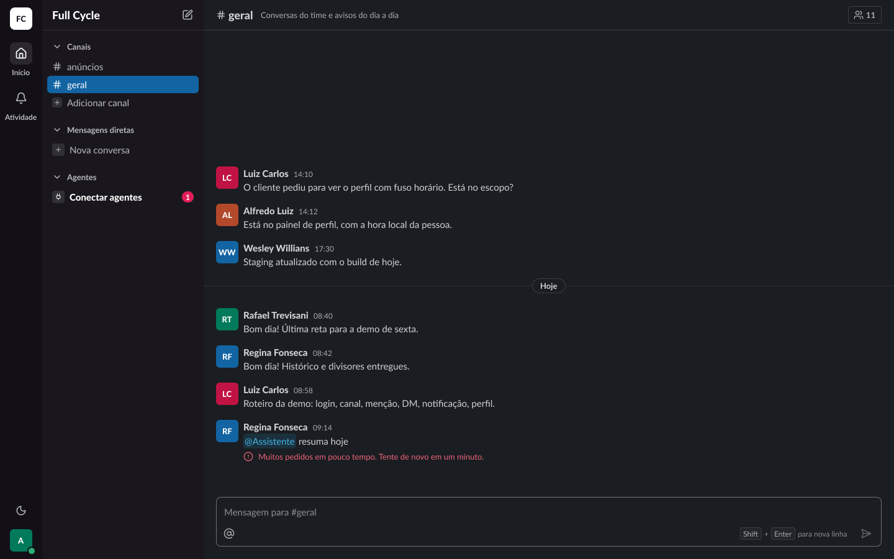
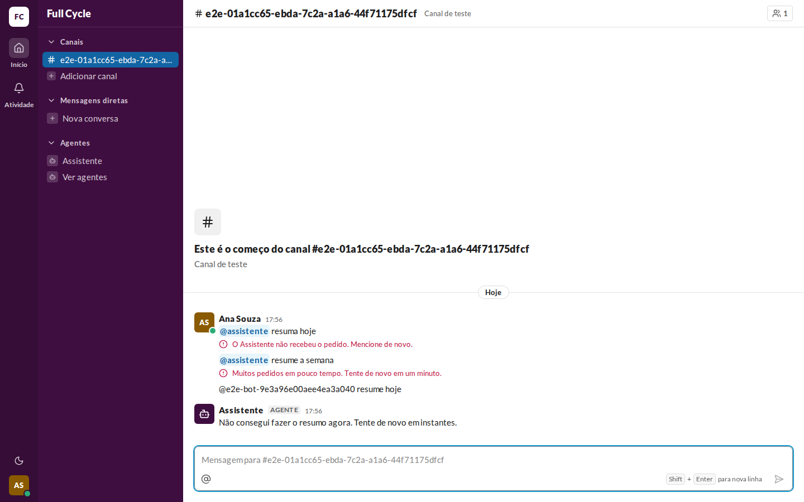
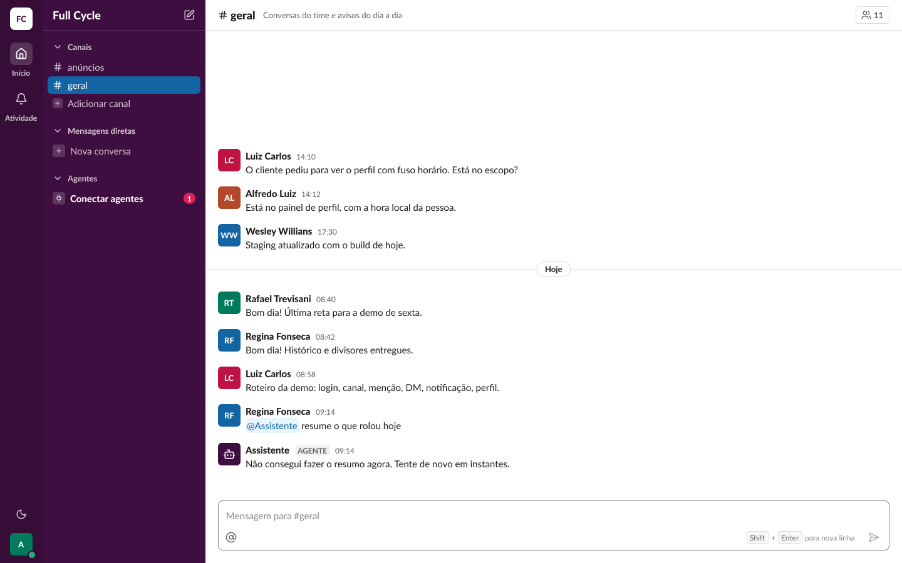
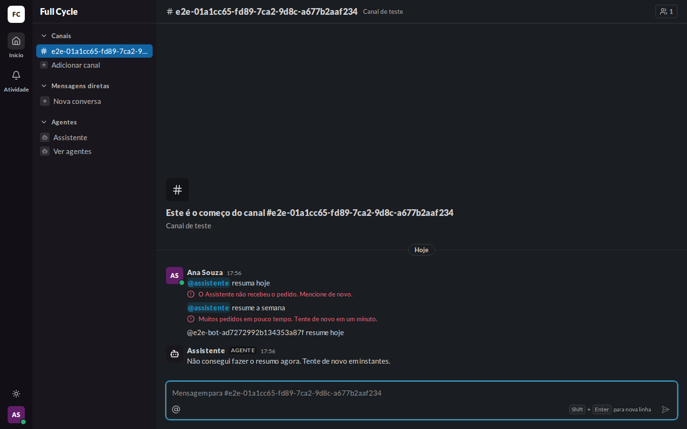
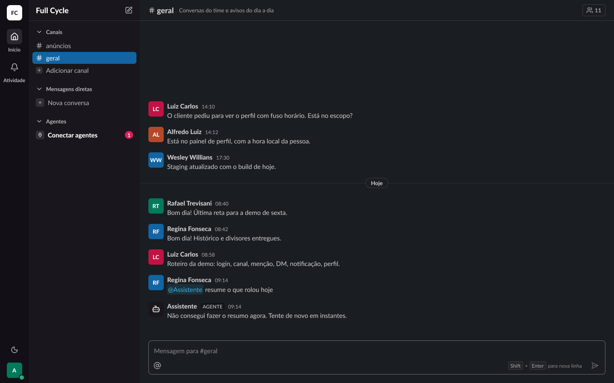

# Validação visual da F11-T06

Capturas da web em 1440 × 900, no Chromium do contêiner `e2e`, na aba de quem pediu, ao lado dos
frames do Figma (arquivo `slack`, página Telas, seção "Conversa"). Os erros vêm do Serviço de
agentes de pé recusando o Pedido pelas chaves do limite da Pessoa no Redis, como no
`e2e/agentes/erro-do-agente.spec.ts`; o "não consegui" foi gravado pelo bot do teste pela `reply`.

| Estado | Web | Figma |
| --- | --- | --- |
| Erro: não recebeu, claro |  |  (Conversa / Mensagem / Erro do agente: não recebeu) |
| Erro: não recebeu, escuro |  |  (Conversa / Mensagem / Erro do agente: não recebeu (escuro)) |
| Erro: limite, claro |  |  (Conversa / Mensagem / Erro do agente: limite de pedidos) |
| Erro: limite, escuro |  |  (Conversa / Mensagem / Erro do agente: limite de pedidos (escuro)) |
| Não consegui, claro |  |  (Conversa / Mensagem / Agente não conseguiu) |
| Não consegui, escuro |  |  (Conversa / Mensagem / Agente não conseguiu (escuro)) |

## O que bate

- A linha do erro logo abaixo do texto da Mensagem enviada, com o ícone `circle-alert` de 16 px e o
  texto em `small/regular` e `text/danger-fg`, sem botões, nos dois textos da spec.
- O "não consegui" como Mensagem do Agente, com o AgentAvatar, o nome, o AgentTag e o texto fixo num
  parágrafo do AgentText.
- Os dois temas pelas variables `Semantic`.

## Diferenças esperadas

- Os dados: o Canal, a Pessoa e as horas do teste, em vez dos do frame, e o histórico curto.
- Na captura do "não consegui", as Mensagens da Ana acima são as das capturas de erro da mesma
  Conversa, e a do Pedido que o bot respondeu menciona um bot de `@usuário` aleatório, que aparece
  como texto (o chip é só para Agente do registro, F10).
- Os frames de erro do Figma já existiam ("Limite de pedidos ao agente" e "Agente não recebeu o
  pedido", do desenho de referência) e foram renomeados e alinhados ao texto da spec; o frame antigo
  "Conversa / Mensagem / Falha do agente", com "Tentar de novo" e "Descartar", continua no arquivo
  como referência e não vale: pela spec, o Agente grava o "não consegui" na Conversa.
