# Validação visual da F11-T07

Capturas da web em 1440 × 900, no Chromium do contêiner `e2e`, ao lado dos frames do Figma (arquivo
`slack`, página Telas, seção "Conversa"). O Pedido nasceu pela rota de envio da API do chat, o bot
do teste gravou a pergunta pela rota `question`, e o `assistente` ficou desconectado, como no
`e2e/agentes/respostas-prontas.spec.ts`: o clique da Ana vira a continuação, que o BFF encerra sem
erro na tela.

| Estado | Web | Figma |
| --- | --- | --- |
| Ativa, para quem pediu, claro | 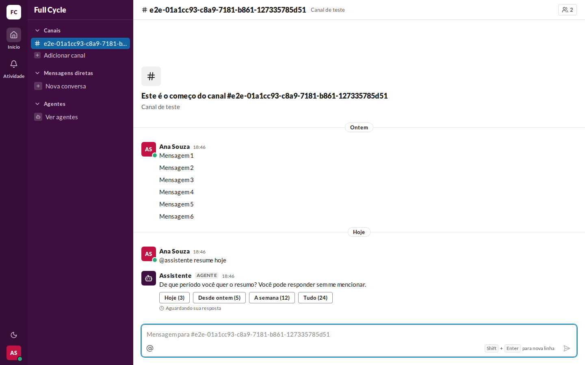 | 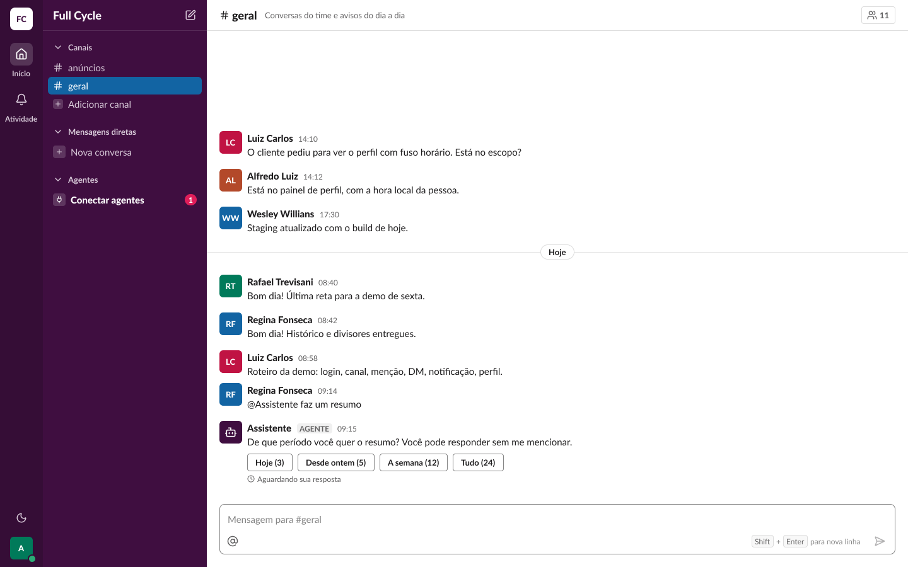 (Conversa / Mensagem / Pergunta do agente) |
| Ativa, para quem pediu, escuro | 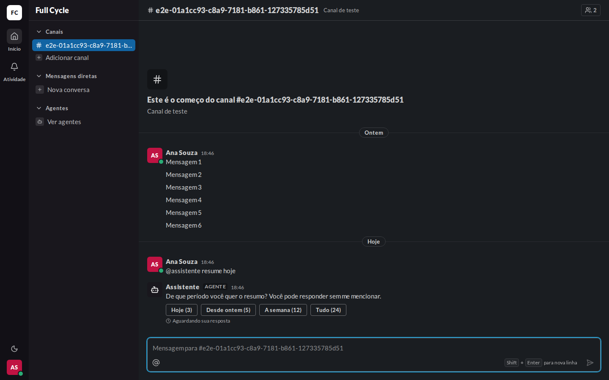 | 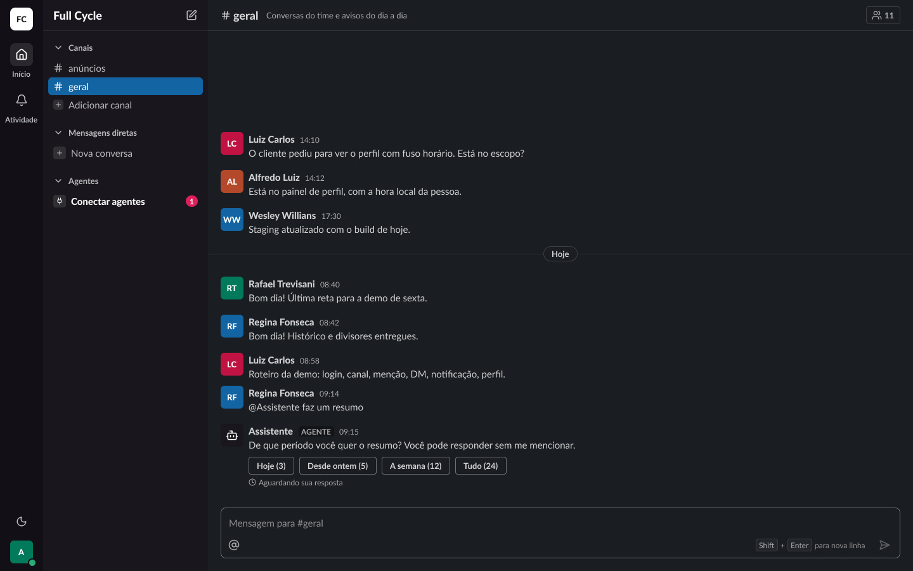 (Conversa / Mensagem / Pergunta do agente (escuro)) |
| Para outro Membro, claro | 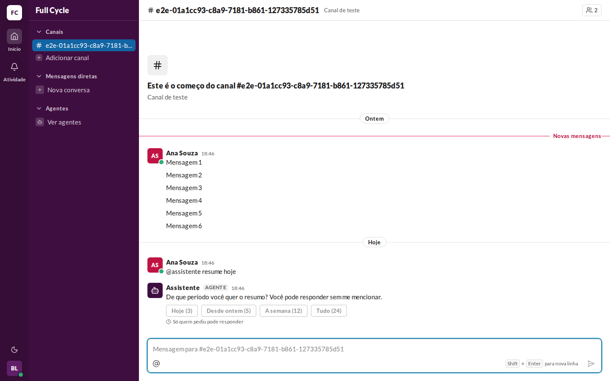 | 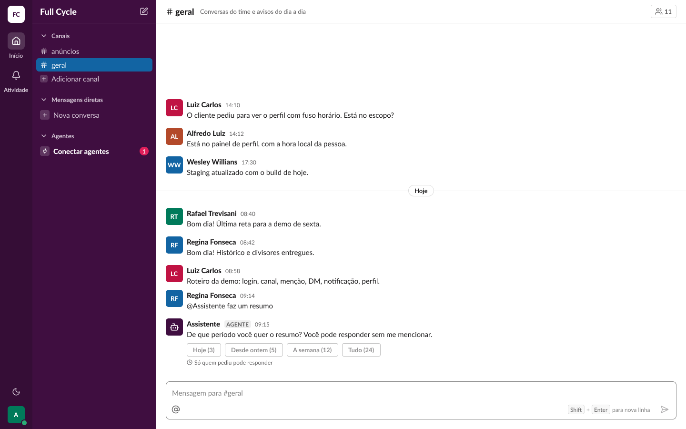 (Conversa / Mensagem / Pergunta do agente para outro Membro) |
| Para outro Membro, escuro | 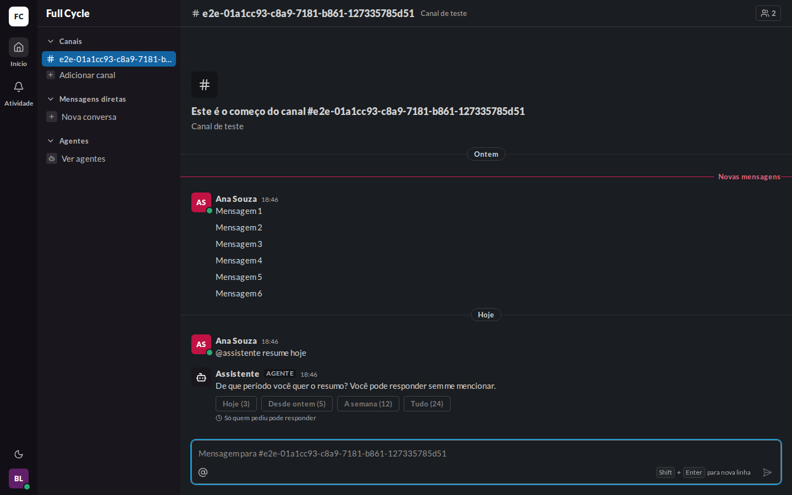 | 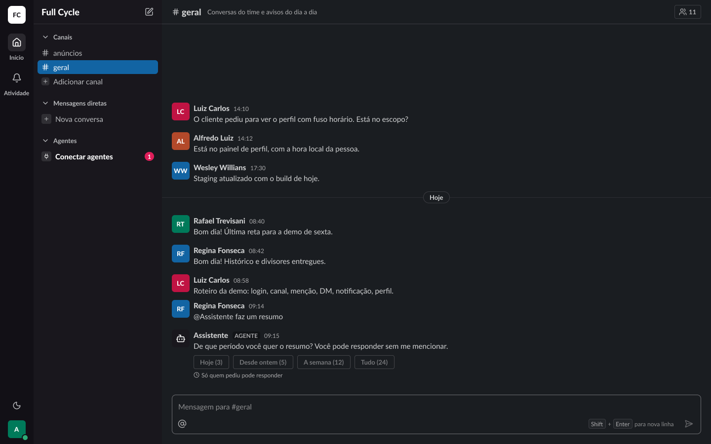 (Conversa / Mensagem / Pergunta do agente para outro Membro (escuro)) |
| Encerrada, claro | 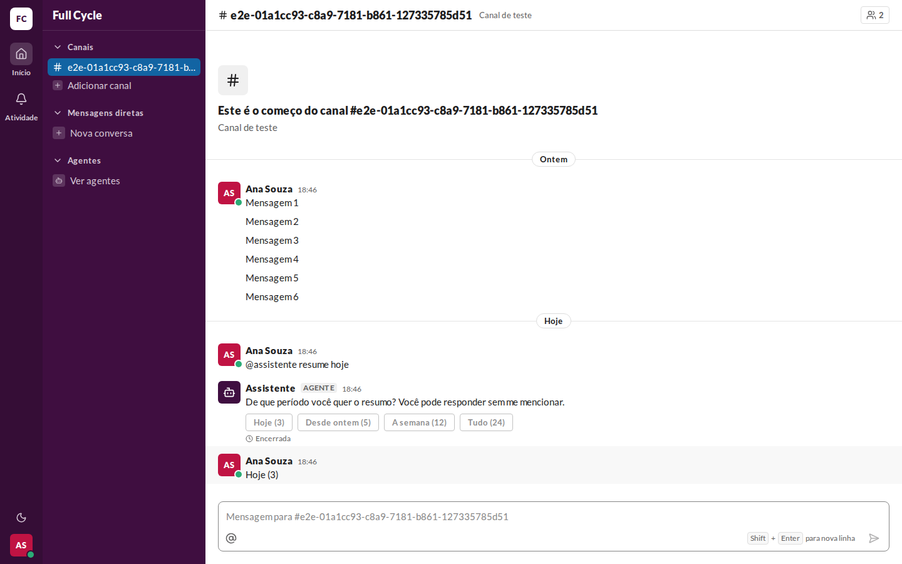 | 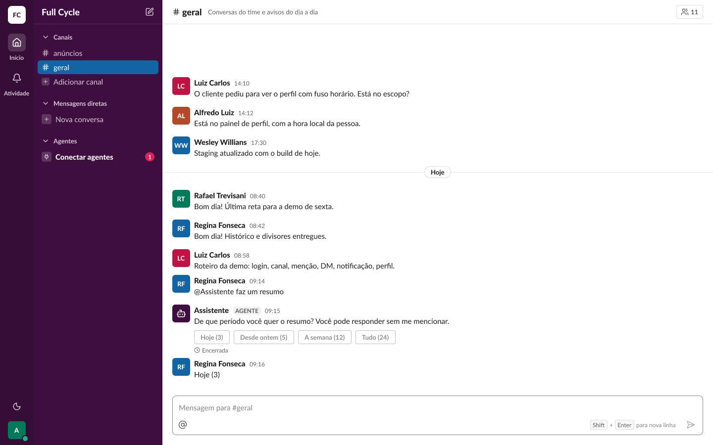 (Conversa / Mensagem / Pergunta do agente encerrada) |
| Encerrada, escuro | 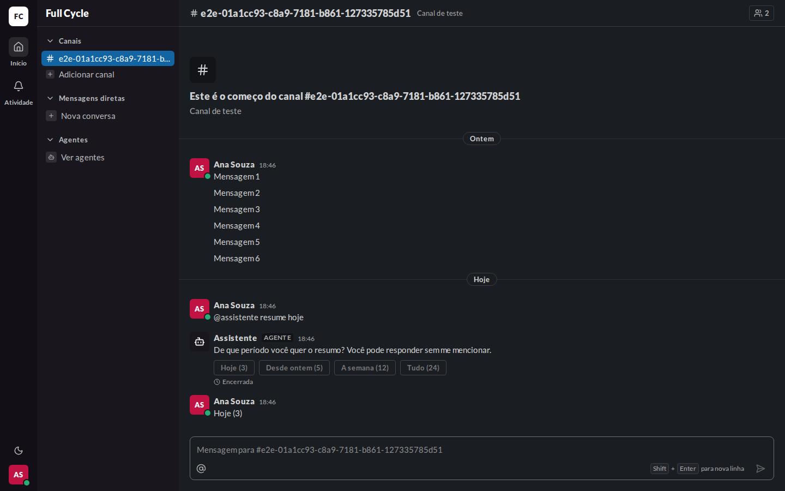 | 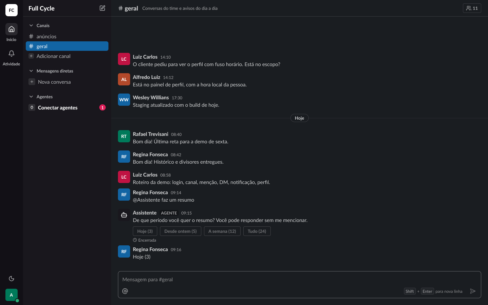 (Conversa / Mensagem / Pergunta do agente encerrada (escuro)) |

## O que bate

- A pergunta como Mensagem do Agente (AgentAvatar, nome, AgentTag e hora), com o texto num
  parágrafo do AgentText em `body/regular`.
- Os quatro botões do Button `secondary` `sm`, com os rótulos "Hoje (N)", "Desde ontem (N)", "A
  semana (N)" e "Tudo (N)", numa linha com `space/2` entre eles e `space/2` acima; desativados com a
  opacidade de `disabled` para outro Membro e depois de encerrada.
- A linha de estado abaixo, com o ícone `clock` de 12 px, `space/1` entre ícone e texto e `space/1`
  acima, em `caption/regular` e `text/fg-muted`: "Aguardando sua resposta", "Só quem pediu pode
  responder" e "Encerrada".
- Na encerrada, a Mensagem "Hoje (3)" de quem pediu logo abaixo da pergunta.
- Os dois temas pelas variables `Semantic`.

## Diferenças esperadas

- Os dados: o Canal, as Pessoas, as horas e o histórico do teste, em vez dos do frame; no Figma, o
  pedido e a resposta são da Regina, e na web, da Ana.
- A captura do outro Membro mostra o divisor "Novas mensagens" do Bruno, que ainda não tinha lido a
  Conversa (F07); o frame não tem divisor.
- O anel de foco na caixa de mensagem, onde o foco fica ao abrir a Conversa.
