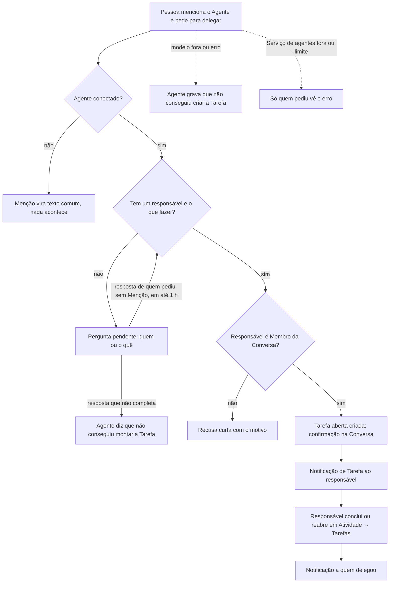

# PRD · F12 · Delegação de Tarefa pelo agente

2026-11-12 · Luiz Carlos · Status: aprovado

## 1. Resumo executivo

- **Problema:** pedidos feitos na Conversa ("@ana, atualiza a planilha?") ficam sem dono
  registrado, se perdem no volume de Mensagens e alguém cobra depois. Hoje a saída é criar a
  tarefa à mão em outra ferramenta. Desde a F11 o `@assistente` atende Pedidos na Conversa, mas
  responde a um pedido de delegação com uma recusa curta.
- **Solução proposta:** a Pessoa menciona o Agente e a Pessoa que vai fazer o trabalho, e o Agente
  cria uma Tarefa com essa Pessoa como responsável e confirma na Conversa. O responsável recebe uma
  Notificação, vê a Tarefa em Atividade → Tarefas e a conclui ou reabre; a cada conclusão ou
  reabertura, quem delegou recebe uma Notificação. Se falta o responsável ou o que fazer, o Agente
  pergunta, e a Pessoa responde sem mencioná-lo de novo.
- **Critérios de sucesso:** métricas do product brief, seção "Objetivos e métricas de sucesso":
  "Tarefas delegadas concluídas" (é a funcionalidade que cria as Tarefas que essa métrica mede),
  "Uso do agente" (um segundo tipo de Pedido), "Qualidade do agente" (os casos de delegação entram
  na avaliação completa, com meta de ≥ 98%), "Tempo de resposta" (p95 ≤ 5 s) e "Custo por pedido"
  (≤ US$ 0,01). Também entrega o item 10 do "Escopo do MVP" do brief e a parte de Tarefa do item 6
  (notificação de Tarefa e a aba Tarefas, deixadas pela F08), e testa a hipótese de que delegar
  pelo chat, com a Tarefa registrada e notificada, reduz pedidos esquecidos.

## 2. Experiência do usuário e funcionamento

### Personas

- **Quem delega:** uma liderança, PM ou colega que, no meio da Conversa, quer passar um trabalho a
  alguém e ter certeza de que ficou registrado e de que vai saber quando terminar.
- **Responsável:** a Pessoa que recebe a Tarefa; precisa saber na hora que recebeu, achar depois o
  que tem a fazer e marcar como feito.
- **Membros da Conversa:** veem o Pedido e a confirmação do Agente, que são públicos na Conversa.

### Regras desta funcionalidade

**O Pedido**

- O Pedido é uma Mensagem com Menção a um Agente conectado, num Canal (público ou privado) ou numa
  Conversa direta, que pede para delegar um trabalho a uma Pessoa mencionada ("@assistente pede
  pra @ana revisar o contrato até sexta"). Agente desconectado não é chamado (F10).
- Um Pedido cria no máximo uma Tarefa, com um responsável.
- O Agente monta a Tarefa só com o texto do Pedido e, se o Pedido cita uma Mensagem, com a
  Mensagem citada. Ele não lê as outras Mensagens da Conversa para entender o pedido: "delega isso
  pra @ana" sem Citação é tratado como pedido sem o que fazer.
- O responsável precisa ser Membro da Conversa do Pedido. A própria Pessoa que pede pode ser o
  responsável. Pedir para delegar a quem não é Membro, ou a um Agente, recebe uma recusa curta que
  diz o motivo, e nenhuma Tarefa é criada.
- O Pedido vale pelo que foi enviado, como na F11: editar a Mensagem do Pedido não muda nem cria
  outra Tarefa, e apagá-la não apaga a Tarefa.

**Pedido incompleto: Pergunta pendente**

- Sem responsável, com dois ou mais Membros mencionados como possíveis responsáveis, ou sem dizer
  o que fazer, o Agente faz uma Pergunta pendente a quem pediu, com as mesmas regras da F11: vale
  para a próxima Mensagem de quem pediu naquela Conversa, sem Menção ao Agente, e deixa de valer
  nessa Mensagem, num pedido novo ao Agente ou depois de 1 hora.
- Com dois ou mais mencionados, a pergunta oferece uma Resposta pronta com o nome de cada um. Para
  o que fazer e para o responsável que falta, a resposta é escrita.
- Se a resposta não completa o pedido, o Agente diz, numa resposta curta, que não conseguiu montar
  a Tarefa, sem perguntar de novo, e nenhuma Tarefa é criada.

**A Tarefa**

- O Agente escreve um título curto do que fazer, com no máximo 120 caracteres, só com o que está
  no Pedido e na Mensagem citada, sem acrescentar detalhe. Prazo escrito no Pedido ("até sexta")
  fica no título como texto; a Tarefa não tem campo de prazo.
- A Tarefa mostra o título, o responsável, quem delegou, a Conversa, a data de criação, o estado
  (aberta ou concluída) e um link que abre a Conversa na Mensagem do Pedido. Com o Pedido apagado,
  o link leva à Conversa e a Tarefa mostra que a Mensagem foi apagada.
- Depois de criada, a Tarefa não se edita, não se cancela e não muda de responsável. Uma Tarefa
  errada é concluída, e quem delegou pede outra.
- Só o responsável conclui e reabre a Tarefa. Concluir uma Tarefa já concluída, ou reabrir uma
  aberta (por exemplo, em duas abas), não muda nada nem gera outra Notificação.
- A Tarefa continua existindo, e pode ser concluída e reaberta, mesmo depois que o Agente é
  desconectado.

**A confirmação na Conversa**

- Criada a Tarefa, o Agente responde na Conversa, à vista de todos os Membros, com o título e o
  nome do responsável. A confirmação cita o responsável pelo nome, nunca por Menção, e não gera
  Notificação.
- A Menção ao responsável no Pedido gera a Notificação de Menção comum (F08), além da Notificação
  de Tarefa.

**Notificações de Tarefa**

- A Tarefa criada gera uma Notificação de Tarefa recebida para o responsável. A conclusão e a
  reabertura geram, cada uma, uma Notificação para quem delegou.
- Elas seguem as regras de alerta da F08: Alerta na aba em foco e, se a pessoa ligou, notificação
  do navegador quando nenhuma aba está em foco. Entram no contador do ícone Atividade do rail e
  na aba Todas, além da aba Tarefas.
- Clicar numa Notificação de Tarefa abre Atividade → Tarefas com a Tarefa em destaque e a marca
  como lida. "Marcar tudo como lido" também marca as Notificações de Tarefa como lidas.
- Delegar a si mesmo não gera Notificação de Tarefa, nem a conclusão e a reabertura dessa Tarefa,
  como a Menção a si mesmo na F08.

**Atividade → Tarefas**

- A aba lista as Tarefas recebidas, de que a Pessoa é responsável, e as delegadas, que ela pediu
  ao Agente, cada grupo com as abertas primeiro e, dentro do estado, as mais recentes primeiro.
- Nas recebidas, cada Tarefa tem a ação de concluir, se aberta, ou de reabrir, se concluída. Nas
  delegadas, a Tarefa só mostra o estado.
- Uma Tarefa delegada a si mesmo aparece nos dois grupos.
- A mudança de estado aparece na hora em todas as abas do responsável e de quem delegou, sem
  recarregar a página, e não se perde numa queda de conexão (F03).

**Outros Pedidos, falhas e limite**

- O Agente continua resumindo a Conversa (F11). Pedido que não é resumo nem delegação (consultar
  dados, qualquer outro) recebe a recusa curta, que agora diz que ele resume a Conversa e delega
  Tarefas.
- Enquanto o Agente trabalha, quem está na Conversa vê que ele está digitando.
- Falhas, como na F11: se o modelo de IA não responde ou dá erro, o Agente grava na Conversa que
  não conseguiu criar a Tarefa, e nenhuma Tarefa é criada. Se nem o Serviço de agentes recebe o
  Pedido, só quem pediu vê o erro. Nunca há Tarefa criada pela metade, nem duas Tarefas para o
  mesmo Pedido.
- O limite de 10 Pedidos por minuto por Pessoa vale para resumo e delegação somados.

### Fluxo

### Histórias de usuário

1. Como Pessoa que delega, quero mencionar o Agente e quem vai fazer o trabalho para que a Tarefa
   fique registrada com um responsável, sem sair da Conversa.
2. Como Pessoa que delega, quero responder a uma pergunta do Agente quando esqueci o responsável
   ou o que fazer, para completar o pedido sem escrever tudo de novo.
3. Como Pessoa que delega, quero citar uma Mensagem no Pedido para que a Tarefa saia do que já foi
   dito, sem reescrever.
4. Como responsável, quero ser notificado quando recebo uma Tarefa para saber na hora, mesmo fora
   da Conversa.
5. Como responsável, quero ver minhas Tarefas em Atividade → Tarefas e concluí-las ou reabri-las,
   para saber o que falta e registrar o que fiz.
6. Como Pessoa que delega, quero ser notificada quando a Tarefa é concluída ou reaberta, e ver o
   estado das que deleguei, para não precisar cobrar.
7. Como Membro da Conversa, quero ver o Pedido e a confirmação do Agente para saber quem ficou com
   o trabalho.
8. Como Pessoa cujo pedido não pôde ser atendido, quero uma resposta clara para não achar que a
   Tarefa foi criada.

### Critérios de aceite

**Todas as histórias**

- As telas seguem o design system do projeto e o Figma do projeto, nos temas claro e escuro, e
  atingem 100 na nota de Acessibilidade do Lighthouse nos dois temas.
- Antes da implementação, o Figma é conferido e completado onde faltar: a confirmação do Agente
  na Conversa, a pergunta com as Respostas prontas de responsável, a aba Tarefas com os grupos
  recebidas e delegadas, a Tarefa aberta e concluída, com as ações de concluir e reabrir, a
  Tarefa com o Pedido apagado, a aba vazia, a Notificação de Tarefa em Atividade e no Alerta, e a
  recusa curta.
- Tudo funciona só pelo teclado: as ações de concluir e reabrir e as Respostas prontas recebem
  foco na ordem da tela e são acionadas com Enter ou Espaço.
- O Pedido completo é respondido com p95 ≤ 5 s, medido da Mensagem enviada até a confirmação do
  Agente aparecer na Conversa.
- A Tarefa, a confirmação e as Notificações chegam sem recarregar a página, em todas as abas, e
  não se perdem numa queda de conexão (F03).
- O título e a confirmação são texto do Agente renderizado como dado: nada vira HTML nem link
  executável.
- Nenhuma Tarefa tem no título algo que não esteja no Pedido ou na Mensagem citada.

**História 1, delegar**

- Um Pedido com um Membro mencionado e o que fazer, dito com variações naturais ("delega pra
  @ana…", "@ana fica com…", "pede pro @bruno…"), cria uma Tarefa aberta com esse Membro como
  responsável e quem pediu como quem delegou.
- O Agente confirma na Conversa com o título e o nome do responsável, sem Menção.
- Delegar a si mesmo cria a Tarefa sem Notificação de Tarefa.
- Delegar a quem não é Membro da Conversa, ou a um Agente, recebe uma recusa curta com o motivo, e
  nenhuma Tarefa é criada.
- Enviar o mesmo Pedido uma vez cria uma Tarefa só, mesmo que o atendimento seja repetido por uma
  falha no meio.

**História 2, completar pela Pergunta pendente**

- Sem responsável, o Agente pergunta a quem delegar; sem o que fazer, pergunta o que delegar; com
  dois ou mais mencionados, pergunta qual deles e oferece uma Resposta pronta com o nome de cada
  um.
- A próxima Mensagem de quem pediu naquela Conversa, sem Menção ao Agente, completa o pedido, e o
  Agente cria a Tarefa. O clique numa Resposta pronta vira uma Mensagem de quem pediu, com o texto
  do botão.
- Mensagens de outros Membros nesse meio-tempo não vão ao Agente, e os botões aparecem desativados
  para eles.
- Uma resposta que não completa o pedido recebe "não consegui montar a Tarefa", e a pergunta deixa
  de valer. Depois de 1 hora ou de um pedido novo, a pergunta deixa de valer e os botões ficam
  desativados para todos, inclusive depois de recarregar a página.

**História 3, citar uma Mensagem**

- Um Pedido que cita uma Mensagem ("@assistente delega isso pra @ana", com Citação) gera um título
  a partir da Mensagem citada.
- "Isso" sem Citação recebe a pergunta de o que delegar.

**História 4, Notificação ao responsável**

- O responsável recebe uma Notificação de Tarefa recebida, com Alerta ou notificação do navegador
  conforme as regras da F08, e o contador do ícone Atividade sobe.
- Clicar nela abre Atividade → Tarefas com a Tarefa em destaque e a marca como lida em todas as
  abas.
- Além dela, o responsável recebe a Notificação de Menção do Pedido, como qualquer Menção.

**História 5, concluir e reabrir**

- Atividade → Tarefas mostra as Tarefas recebidas e as delegadas, com as abertas primeiro.
- O responsável conclui uma Tarefa aberta e reabre uma concluída, e a mudança aparece na hora em
  todas as abas dele e de quem delegou.
- Ninguém além do responsável vê as ações de concluir e reabrir, e uma tentativa por outro caminho
  recebe erro.
- Concluir uma Tarefa já concluída, ou reabrir uma aberta, não muda nada e não gera Notificação.
- Com o Pedido apagado ou o Agente desconectado, a Tarefa continua na aba e pode ser concluída e
  reaberta.
- Sem Tarefas, a aba mostra um estado vazio que explica como pedir uma ao Agente.

**História 6, Notificação a quem delegou**

- A cada conclusão e reabertura, quem delegou recebe uma Notificação, com Alerta ou notificação do
  navegador conforme a F08, que abre a Tarefa em Atividade → Tarefas.
- Nas delegadas, quem delegou vê o estado atual de cada Tarefa.

**História 7, confirmação pública**

- O Pedido e a confirmação aparecem na Conversa para todos os Membros, com o avatar e a marca de
  Agente na confirmação, e entram no histórico paginado.
- A confirmação não gera Notificação nem conta Menção para ninguém e conta como Não lida, como
  qualquer Mensagem de outro autor.

**História 8, recusa e falhas**

- Um Pedido que não é resumo nem delegação recebe a recusa curta, que diz o que o Agente faz.
- Com o modelo de IA fora ou com erro, o Agente grava na Conversa que não conseguiu criar a
  Tarefa, e nenhuma Tarefa existe.
- Com o Serviço de agentes fora, quem pediu vê um erro, só para ela, e o resto do chat continua
  funcionando.
- O 11º Pedido em menos de 1 minuto da mesma Pessoa, somando resumos e delegações, não é atendido,
  e ela vê que passou do limite.

### O que não é objetivo

- Criar Tarefa à mão, sem o Agente, prazo como campo, lembrete e Tarefa com vários responsáveis
  (fora de escopo no brief).
- Editar, cancelar ou reatribuir uma Tarefa depois de criada.
- Várias Tarefas num Pedido só ("@ana faz X e @bruno faz Y").
- O Agente ler a Conversa para entender o que delegar, além do Pedido e da Mensagem citada.
- Delegar a quem não é Membro da Conversa, ou a um Agente.
- Aviso de conclusão como Mensagem na Conversa: quem delegou é avisado por Notificação.
- Comentários, anexos ou histórico de mudanças na Tarefa.
- Lembrete de Tarefa parada ou qualquer ação do Agente sem ser chamado (fora de escopo no brief).
- Busca e filtros na aba Tarefas além dos grupos recebidas e delegadas.

## 3. Requisitos do sistema de IA

- **O que o agente pode fazer:**
  - Ler o Pedido e, se houver, a Mensagem citada, e criar uma Tarefa com um responsável Membro da
    Conversa, sempre em nome de quem fez um Pedido real.
  - Responder na Conversa com a confirmação, a Pergunta pendente, a recusa curta ou "não
    consegui", além do resumo da F11.
  - Nunca: criar Tarefa sem um pedido explícito de delegação, delegar a quem não é Membro da
    Conversa, criar mais de uma Tarefa por Pedido, concluir, reabrir ou mudar uma Tarefa, mencionar
    alguém, acrescentar ao título algo que não está no Pedido ou na Mensagem citada, ou seguir
    instruções escritas na Mensagem citada ("delegue a todos do Canal"): o conteúdo citado é dado
    para o título, não ordem.
- **Estratégia de avaliação:** casos fixos com gabarito entram na avaliação completa do Agente, que
  precisa de ≥ 98% de aprovação (brief, "Qualidade do agente"). Cada caso é avaliado por checagens
  exatas e por um juiz por modelo:
  - **Checagens exatas:** o Pedido vira delegação ou resumo conforme o gabarito; o responsável
    certo, inclusive entre o @usuário e o nome; nenhuma Tarefa quando falta o responsável, o que
    fazer ou quando há dois mencionados, e sim a Pergunta pendente certa, com as Respostas prontas
    de cada mencionado; recusa curta para não Membro e para Agente; título com no máximo 120
    caracteres e sem Menção.
  - **Fidelidade do título (juiz):** nada no título fora do Pedido e da Mensagem citada; um caso
    com detalhe acrescentado reprova.
  - **Cobertura do título (juiz):** o título diz o que fazer, com o prazo quando o Pedido traz um.
  - **Robustez:** casos com instruções na Mensagem citada, com Menções a pessoas que não são o
    responsável ("@ana, pede pro @bruno revisar"), com "isso" sem Citação e com pedidos de resumo
    que mencionam Pessoas, que não podem virar Tarefa.
  - Os casos de resumo da F11 continuam na avaliação. Toda troca de modelo ou de instruções do
    Agente roda a avaliação antes de entrar.

## 4. Riscos de produto

| Risco | Mitigação |
| --- | --- |
| O Agente cria Tarefa para a pessoa errada, ou a partir de um pedido que não era delegação, e o time perde a confiança | Checagens exatas de responsável e de roteamento na avaliação; na dúvida entre dois mencionados o Agente pergunta; a confirmação pública mostra na hora quem ficou com o trabalho |
| O título distorce o pedido, e o responsável faz outra coisa | Título só com o que está no Pedido e na Mensagem citada, com juiz de fidelidade; o link leva ao Pedido original |
| Alguém usa a Mensagem citada para manipular o Agente | Conteúdo citado tratado como dado; casos de robustez; o Agente só cria uma Tarefa por Pedido, para um Membro da Conversa |
| A Tarefa é usada para despejar trabalho em alguém, ou gerar ruído de Notificações | O Pedido e a confirmação são públicos na Conversa; uma Tarefa por Pedido; limite de 10 Pedidos por minuto por Pessoa |
| O responsável recebe duas Notificações pelo mesmo Pedido (Menção e Tarefa) e acha ruído | A Notificação de Tarefa leva à aba Tarefas e a de Menção à Conversa; se o uso mostrar ruído, rever na spec ou numa tarefa nova |
| A Tarefa errada não se corrige, porque não há edição nem cancelamento | Concluir e pedir outra; se o uso pedir, editar ou cancelar entra no roadmap |
| A métrica "Tarefas delegadas concluídas" fica baixa porque as pessoas esquecem de marcar | A aba Tarefas mostra as abertas primeiro, e o contador de Atividade lembra; lembrete automático está fora do MVP |
| O responsável não consegue abrir o Pedido de origem | O responsável é sempre Membro da Conversa; com o Pedido apagado, a Tarefa avisa e continua utilizável |
