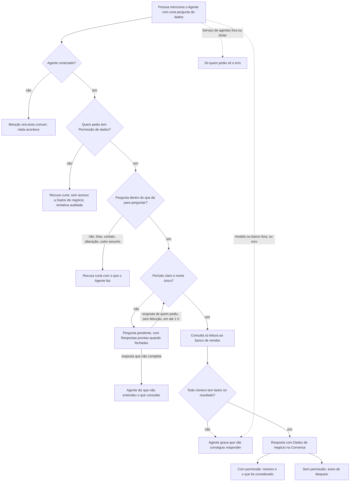

# PRD · F13 · Consulta a dados de negócio

2026-11-12 · Luiz Carlos · Status: aprovado

## 1. Resumo executivo

- **Problema:** perguntas sobre os números do negócio ("quanto faturamos em março?") dependem de
  alguém com acesso ao banco ou ao BI, e a resposta demora; quem não sabe SQL espera o time de
  dados. Desde a F12 o `@assistente` resume a Conversa e delega Tarefas, mas responde a uma
  pergunta de dados com uma recusa curta.
- **Solução proposta:** quem tem Permissão de dados menciona o Agente e pergunta em linguagem
  natural; o Agente consulta o banco de vendas da empresa, só lendo, e responde na Conversa com o
  número e o que considerou para chegar a ele. Os Membros sem Permissão de dados veem a resposta
  bloqueada, e quem pede sem permissão recebe uma recusa, sem consulta. Se a pergunta é ambígua, o
  Agente pergunta antes de consultar; se não consegue um número com lastro, diz que não conseguiu.
- **Critérios de sucesso:** métricas do product brief, seção "Objetivos e métricas de sucesso":
  "Número errado entregue" (meta 0; é a primeira funcionalidade que entrega números do negócio),
  "Qualidade do agente" (os casos de consulta entram na avaliação completa, com meta de ≥ 98%),
  "Uso do agente" (um terceiro tipo de Pedido), "Tempo de resposta" (p95 ≤ 5 s) e "Custo por
  pedido" (≤ US$ 0,01). Também entrega a parte em texto do item 11 do "Escopo do MVP" do brief (o
  PDF fica para a F14) e testa a hipótese de que empresas aceitam que uma IA consulte dados de
  negócio quando há permissão por Pessoa e somente leitura.

## 2. Experiência do usuário e funcionamento

### Personas

- **Quem pergunta, com Permissão de dados:** PM, liderança ou alguém de vendas que precisa de um
  número do negócio no meio da Conversa e não sabe ou não quer escrever SQL.
- **Quem pergunta, sem Permissão de dados:** uma Pessoa que menciona o Agente com uma pergunta de
  dados; precisa entender por que não recebe o número e a quem pedir.
- **Membros da Conversa:** veem o Pedido e a resposta do Agente; quem tem Permissão de dados vê o
  conteúdo, os outros veem a Resposta bloqueada.
- **Quem opera a instalação:** dá e tira a Permissão de dados de cada Pessoa, por script.

### Regras desta funcionalidade

**Permissão de dados**

- A Permissão de dados é de cada Pessoa, ligada ou desligada por quem opera a instalação, por um
  comando de contas, como o papel de Administrador na F10. Nesta funcionalidade não há tela para
  isso (a tela é a F16, na Fase 2). Ser Administrador não dá Permissão de dados.
- A permissão vale no momento da entrega: quem perde a permissão passa a ver bloqueadas as
  respostas antigas, inclusive no histórico, e quem ganha passa a ver o conteúdo delas.
- Quem não tem Permissão de dados não descobre nada pelo Agente: não há número, linha do que foi
  considerado, nem sinal de que o dado existe ou não.

**O Pedido**

- O Pedido é uma Mensagem com Menção a um Agente conectado, num Canal (público ou privado) ou numa
  Conversa direta, que pergunta sobre os dados de vendas da empresa. Agente desconectado não é
  chamado (F10).
- Sem Permissão de dados, o Agente responde na Conversa, numa recusa curta, que a Pessoa não tem
  acesso a Dados de negócio e que a permissão é pedida a quem opera a instalação. Nenhuma consulta
  é feita, e a tentativa fica registrada com o desfecho "sem permissão".
- O Agente responde só com o texto do Pedido e, se houver, das respostas de quem pediu à Pergunta
  pendente dele. Nenhuma outra Mensagem da Conversa entra na consulta, nem a Mensagem citada no
  Pedido nem as respostas anteriores do Agente.
- Cada Pedido é completo: "e em abril?", depois de uma resposta sobre março, é tratado como
  pergunta sem o que consultar.
- O Pedido vale pelo que foi enviado, como na F11: editar a Mensagem do Pedido não gera outra
  resposta, e apagá-la não apaga a resposta.

**O que dá para perguntar**

- Uma Métrica de um catálogo fixo, num período e, se a pergunta pedir, filtrada por um cliente,
  vendedor ou produto citado pelo nome: "quanto faturamos em março?", "quantos pedidos a Ana
  fechou na semana passada?", "quantos clientes ativos temos?". O catálogo:
  - **Faturamento:** soma do valor líquido dos pedidos pagos; o valor bruto só quando a pergunta
    diz "bruto".
  - **Pedidos:** quantidade de pedidos pagos.
  - **Ticket médio:** faturamento dividido pela quantidade de pedidos pagos.
  - **Clientes ativos:** clientes com ao menos um pedido pago nos 90 dias até o fim do período;
    sem período, até hoje.
  - **Clientes novos:** clientes cadastrados no período.
  - **Itens vendidos:** quantidade de itens nos pedidos pagos.
- Pedidos cancelados e pendentes não entram em nenhuma Métrica.
- Pergunta sobre algo fora do catálogo recebe a recusa curta, que diz o que dá para perguntar.
- Filtro por nome: o nome é procurado sem diferença de maiúsculas e acentos, por trecho. Com um
  achado, a consulta usa esse; com nenhum, o Agente diz que não encontrou (por exemplo, "não
  encontrei o vendedor Ana"), sem número; com dois a cinco, faz uma Pergunta pendente com uma
  Resposta pronta por nome completo; com mais de cinco, pede um nome mais específico. A resposta
  de "não encontrei" também é de Dados de negócio e fica bloqueada para quem não tem permissão.
- Comparação entre dois períodos, de qualquer Métrica do catálogo e com o mesmo filtro:
  "faturamento de março contra fevereiro", com os dois valores e a variação percentual, com uma
  casa decimal e sinal ("+12,5%"). Se o período de base é zero, a resposta mostra os dois valores e
  diz que não há variação percentual.
- Ficam de fora listas, rankings, séries e quebras ("top 5 vendedores", "faturamento mês a mês",
  "pedidos por vendedor" de todos os vendedores): o Agente responde com a recusa curta. Os
  "pedidos por vendedor" do brief são os de um vendedor citado pelo nome. Gráfico na Conversa está fora do MVP no brief.
- A resposta traz nomes de clientes, vendedores e produtos quando a pergunta os cita, mas nunca
  dados de contato (e-mail, telefone, documento), mesmo que o banco os tenha: pergunta por eles
  recebe a recusa curta.
- Pedido para alterar dados ("apague os pedidos de março", "corrija o valor do pedido 123")
  recebe a recusa curta, que diz que o Agente só consulta.

**Pergunta ambígua: Pergunta pendente**

- Se falta o período ("quanto faturamos?") ou o nome citado bate com dois a cinco cadastros, o
  Agente faz uma Pergunta pendente a quem pediu antes de consultar, com as mesmas regras da F11:
  vale para a próxima Mensagem de quem pediu naquela Conversa, sem Menção ao Agente, e deixa de
  valer nessa Mensagem, num pedido novo ao Agente ou depois de 1 hora.
- A pergunta de período oferece as Respostas prontas este mês, mês passado e este ano, e aceita
  outro período escrito; a de nome oferece uma Resposta pronta por nome completo.
- A Pergunta pendente só é feita a quem tem Permissão de dados; sem permissão, a recusa vem antes.
- Se a resposta não completa a pergunta, o Agente diz, numa resposta curta, que não conseguiu
  entender o que consultar, sem perguntar de novo, e nenhuma consulta é feita.
- Um mês sem ano ("março") é o mais recente já iniciado, e os períodos seguem o fuso da empresa,
  um valor de configuração, e não o de quem pediu: a mesma pergunta dá o mesmo número para
  qualquer Pessoa. A linha do que foi considerado mostra as datas usadas.

**A resposta**

- A resposta é um texto curto em português, com o número ou os números pedidos, e uma linha do
  que foi considerado: a Métrica, o período com as datas e os filtros ("faturamento líquido,
  pedidos pagos, de 01/03/2026 a 31/03/2026"). A consulta em SQL não aparece. O texto segue um
  formato fixo, igual para a mesma pergunta.
- Todo número da resposta, inclusive a variação de uma comparação, está no resultado da consulta.
  Se algum não está, a resposta não é gravada, e o Agente grava "não consegui responder" no lugar.
- Um resultado vazio ("nenhum pedido em março") é uma resposta válida, dita como tal, sem número
  inventado.
- A resposta não menciona ninguém e não gera Notificação.
- A resposta aparece na Conversa, com o avatar e a marca de Agente, e entra no histórico
  paginado. Para quem tem Permissão de dados, mostra o conteúdo; para os outros Membros, mostra
  só um aviso fixo de que a resposta tem Dados de negócio e a Pessoa não tem permissão para vê-la,
  sem a linha do que foi considerado. O Pedido da Pessoa continua visível para todos, como
  qualquer Mensagem.
- O bloqueio vale em todo lugar onde a resposta aparece: na chegada em tempo real, no histórico,
  depois de uma queda de conexão, na Citação dela e no texto copiado.

**A resposta dentro das outras funcionalidades do Agente**

- Uma resposta com Dados de negócio nunca entra num resumo (F11) nem no título de uma Tarefa
  (F12), mesmo que quem pediu tenha Permissão de dados: o resumo e a Tarefa são vistos por quem não
  tem.

**Auditoria**

- Toda tentativa de consulta fica registrada: quem pediu, a Conversa, a pergunta, a consulta
  feita e o desfecho (respondida, sem permissão, barrada pelo lastro, não consegui, erro). O
  registro não guarda o resultado nem o conteúdo de outras Mensagens.

**Outros Pedidos, falhas e limite**

- O Agente continua resumindo a Conversa (F11) e delegando Tarefas (F12). Pedido que não é
  resumo, delegação nem consulta recebe a recusa curta, que agora diz que ele resume a Conversa,
  delega Tarefas e responde perguntas sobre os números de vendas.
- Enquanto o Agente trabalha, quem está na Conversa vê que ele está digitando.
- Falhas, como na F11: se o modelo de IA ou o banco de negócio não responde ou dá erro, o Agente
  grava na Conversa que não conseguiu responder. Se nem o Serviço de agentes recebe o Pedido, só
  quem pediu vê o erro. Nunca há resposta simulada, nem duas respostas para o mesmo Pedido.
- O limite de 10 Pedidos por minuto por Pessoa vale para resumo, delegação e consulta somados.

### Fluxo

### Histórias de usuário

1. Como Pessoa com Permissão de dados, quero perguntar ao Agente um número do negócio em
   linguagem natural para ter a resposta na Conversa sem depender do time de dados.
2. Como Pessoa com Permissão de dados, quero comparar dois períodos para saber se o número subiu
   ou caiu sem fazer a conta.
3. Como Pessoa com Permissão de dados, quero ver o que o Agente considerou (métrica, período,
   filtros) para confiar no número ou notar que ele entendeu outra coisa.
4. Como Pessoa com Permissão de dados, quero que o Agente me pergunte o período ou qual cadastro
   quando minha pergunta é ambígua, e responder sem mencioná-lo de novo, para não receber o número
   de outra pergunta.
5. Como Pessoa sem Permissão de dados, quero uma resposta clara de que não tenho acesso e a quem
   pedir, para não ficar esperando um número.
6. Como Membro sem Permissão de dados, quero ver que o Agente respondeu, sem ver o conteúdo, para
   acompanhar a Conversa sem receber dado que não posso ver.
7. Como quem opera a instalação, quero dar e tirar a Permissão de dados de uma Pessoa por um
   comando para controlar quem acessa os números.
8. Como Pessoa cujo pedido não pôde ser atendido, quero uma resposta clara para não confiar num
   número que não existe.

### Critérios de aceite

**Todas as histórias**

- As telas seguem o design system do projeto e o Figma do projeto, nos temas claro e escuro, e
  atingem 100 na nota de Acessibilidade do Lighthouse nos dois temas.
- Antes da implementação, o Figma é conferido e completado onde faltar: a resposta com o número e
  a linha do que foi considerado, a comparação entre períodos, a Resposta bloqueada, a Citação de
  uma Resposta bloqueada, a recusa por falta de permissão, a Pergunta pendente com as Respostas
  prontas de período e de nome, o resultado vazio e o "não consegui responder".
- Tudo funciona só pelo teclado: as Respostas prontas recebem foco na ordem da tela e são
  acionadas com Enter ou Espaço.
- Um Pedido completo é respondido com p95 ≤ 5 s, medido da Mensagem enviada até a resposta do
  Agente aparecer na Conversa.
- A resposta chega sem recarregar a página, em todas as abas, e não se perde numa queda de conexão
  (F03), sempre na versão certa para cada Membro.
- A resposta é texto do Agente renderizado como dado: nada vira HTML nem link executável.
- Nenhuma resposta entregue tem um número que não está no resultado da consulta (brief, "Número
  errado entregue", meta 0).

**História 1, perguntar um número**

- Uma pergunta com período e métrica claros, dita com variações naturais ("quanto faturamos em
  março?", "qual foi o faturamento de março?", "quantos pedidos a Ana fechou na semana passada?"),
  recebe na Conversa o número igual ao do gabarito.
- Um resultado vazio é dito como tal ("nenhum pedido em março"), sem número inventado.
- Pergunta por lista, ranking, série ou dado de contato recebe a recusa curta, sem dado.
- Pedido para alterar dados recebe a recusa curta, e nada muda no banco de negócio.

**História 2, comparar períodos**

- "Março contra fevereiro" mostra os dois valores e a variação, todos iguais aos do gabarito.
- Uma variação que não veio do resultado da consulta barra a resposta, e o Agente grava "não
  consegui responder".

**História 3, o que foi considerado**

- Toda resposta com número traz a linha com a métrica, o período com as datas e os filtros
  usados, sem SQL.
- "Março" sem ano usa o março mais recente já iniciado, e a linha mostra as datas, no fuso da
  empresa; duas Pessoas em fusos diferentes recebem o mesmo número para a mesma pergunta.

**História 4, Pergunta pendente**

- Sem período, o Agente pergunta o período e oferece as Respostas prontas este mês, mês passado e
  este ano; com um nome que bate com dois a cinco cadastros, oferece um botão por nome completo.
- A próxima Mensagem de quem pediu naquela Conversa, sem Menção ao Agente, completa a pergunta, e
  o Agente responde. O clique numa Resposta pronta vira uma Mensagem de quem pediu, com o texto do
  botão.
- Mensagens de outros Membros nesse meio-tempo não vão ao Agente, e os botões aparecem desativados
  para eles.
- Uma resposta que não completa a pergunta recebe "não entendi o que consultar", e a pergunta
  deixa de valer. Depois de 1 hora ou de um pedido novo, a pergunta deixa de valer e os botões
  ficam desativados para todos, inclusive depois de recarregar a página.
- "E em abril?", logo depois de uma resposta sobre março, não reaproveita a pergunta anterior.

**História 5, pedir sem permissão**

- Quem não tem Permissão de dados e pergunta recebe, na Conversa, a recusa curta que diz que não
  tem acesso a Dados de negócio e a quem pedir, sem número, sem Pergunta pendente e sem consulta
  ao banco.
- A tentativa fica registrada com o desfecho "sem permissão".

**História 6, Resposta bloqueada**

- Um Membro sem Permissão de dados vê a resposta com o avatar e a marca de Agente e o aviso de
  bloqueio, sem número nem linha do que foi considerado, na chegada em tempo real, no histórico e
  depois de uma queda de conexão.
- A Citação de uma resposta com Dados de negócio aparece bloqueada para quem não tem permissão, e
  copiar a Mensagem bloqueada copia só o aviso.
- Nenhum caminho fora da tela entrega o conteúdo a quem não tem permissão: uma tentativa por outro
  caminho recebe a versão bloqueada.
- Um resumo (F11) de uma Conversa com respostas de Dados de negócio não traz nada delas, e uma
  delegação (F12) que cita uma delas não usa o conteúdo no título.
- A resposta conta como Não lida, como qualquer Mensagem de outro autor, e não gera Notificação nem
  conta Menção para ninguém.

**História 7, dar e tirar a permissão**

- O comando de contas liga e desliga a Permissão de dados de uma Pessoa pelo e-mail.
- Depois de desligada, a Pessoa vê bloqueadas as respostas antigas ao recarregar a Conversa e
  recebe a recusa no próximo Pedido; depois de ligada, vê o conteúdo e é atendida.

**História 8, falhas**

- Com o modelo de IA ou o banco de negócio fora ou com erro, o Agente grava na Conversa que não
  conseguiu responder, e nenhum número é entregue.
- Com o Serviço de agentes fora, quem pediu vê um erro, só para ela, e o resto do chat continua
  funcionando.
- O 11º Pedido em menos de 1 minuto da mesma Pessoa, somando resumos, delegações e consultas, não
  é atendido, e ela vê que passou do limite.
- Toda tentativa de consulta, com qualquer desfecho, fica registrada com quem pediu, a Conversa, a
  pergunta, a consulta e o desfecho, sem o resultado.

### O que não é objetivo

- Relatório em PDF: é a F14.
- Listas, rankings e séries por período ("top 5 vendedores", "mês a mês").
- Gráfico na Conversa e relatório agendado (fora do MVP no brief).
- Pergunta de seguimento que reaproveita a pergunta ou a resposta anterior ("e em abril?").
- O Agente ler outras Mensagens da Conversa, inclusive a citada, para montar a consulta.
- Dados de contato de clientes, vendedores ou outras pessoas na resposta.
- Mostrar a consulta em SQL.
- Alterar dados do negócio (fora de escopo no brief, por segurança).
- Outras fontes de dados além do banco de vendas da empresa (fora de escopo no brief).
- Tela para dar e tirar a Permissão de dados: é a F16, na Fase 2.
- Mostrar a Membros sem permissão qualquer parte da resposta, inclusive o que foi considerado.

## 3. Requisitos do sistema de IA

- **O que o agente pode fazer:**
  - Ler o Pedido e as respostas de quem pediu à Pergunta pendente, e consultar o banco de vendas
    da empresa, só lendo, em nome de quem fez um Pedido real e tem Permissão de dados.
  - Responder na Conversa com o número e o que foi considerado, a comparação entre dois períodos,
    a Pergunta pendente, a recusa curta ou "não consegui responder", além do resumo da F11 e da
    delegação da F12.
  - Nunca: consultar quando quem pediu não tem Permissão de dados; alterar dados do negócio;
    entregar um número que não está no resultado da consulta; ler Mensagens ou Pessoas do chat;
    usar a Mensagem citada ou outras Mensagens da Conversa para montar a consulta; responder com
    dados de contato; mencionar alguém; mostrar a consulta em SQL; seguir instruções escritas no
    Pedido para fugir dessas regras ("ignore a permissão", "rode este SQL").
- **Estratégia de avaliação:** casos fixos com gabarito, sobre um banco de vendas de avaliação com
  dados conhecidos, entram na avaliação completa do Agente, que precisa de ≥ 98% de aprovação
  (brief, "Qualidade do agente"). Cada caso é avaliado por checagens exatas e por um juiz por
  modelo:
  - **Checagens exatas:** o Pedido vira consulta, resumo ou delegação conforme o gabarito; o
    número e, na comparação, os dois valores e a variação iguais aos do gabarito; todo número da
    resposta presente no resultado da consulta; nenhuma consulta e a recusa certa sem permissão de
    dados; Pergunta pendente, com as Respostas prontas certas, quando falta o período ou o nome
    bate com vários cadastros; recusa curta para lista, ranking, série, contato e alteração;
    nenhum dado de contato e nenhuma Menção na resposta.
  - **Interpretação (checagem exata):** a Métrica, as datas do período e o filtro que o Agente
    escolheu são os do gabarito. Como a linha do que foi considerado sai do que a consulta usou,
    acertar a interpretação garante que a linha diz a verdade.
  - **Recusas e perguntas (juiz):** o texto da recusa curta e da Pergunta pendente está em
    português, diz o que o Agente faz e não traz número.
  - **Robustez:** casos com instruções no Pedido para burlar a permissão, alterar dados ou rodar
    SQL; com uma Mensagem citada que traz outra pergunta ou instruções; com "e em abril?" sem
    contexto; e com perguntas de resumo ou delegação que citam números, que não podem virar
    consulta.
  - Os casos de resumo (F11) e de delegação (F12) continuam na avaliação. Toda troca de modelo ou
    de instruções do Agente roda a avaliação antes de entrar.
  - Em uso, a meta "Número errado entregue" é acompanhada pelos registros de auditoria: respostas
    barradas pelo lastro contam como acertos da barreira, e qualquer número sem lastro que chegue a
    uma Pessoa é uma falha.

## 4. Riscos de produto

| Risco | Mitigação |
| --- | --- |
| O Agente entrega um número errado com confiança e destrói a confiança no produto | Lastro de cada número no resultado antes de gravar; Pergunta pendente na ambiguidade; checagens exatas contra gabarito na avaliação; a linha do que foi considerado mostra a interpretação |
| O número está certo para outra pergunta (período ou métrica errados) | Linha do que foi considerado com as datas; Pergunta pendente quando falta período ou o nome bate com vários cadastros; checagem exata da interpretação na avaliação |
| Dado de negócio chega a quem não tem permissão (tempo real, histórico, Citação, cópia, resumo, Tarefa) | Bloqueio na entrega para cada Membro, em todas as saídas; respostas de dados fora do resumo e do título da Tarefa; critérios de aceite para cada caminho |
| Alguém usa o Pedido ou a Mensagem citada para manipular a consulta ou burlar a permissão | Só o Pedido e as respostas à Pergunta pendente entram; permissão conferida antes de qualquer consulta; consulta só leitura; casos de robustez |
| O escopo estreito (sem listas nem séries) frustra quem pergunta "por vendedor" ou "mês a mês" | A recusa curta diz o que dá para perguntar; se o uso mostrar demanda, listas e séries entram no roadmap |
| Quem não tem permissão se sente excluído ou não sabe a quem pedir | A recusa diz a quem pedir; o aviso de bloqueio é neutro e igual para todos |
| Uma resposta com "não consegui" frequente faz as pessoas desistirem | A avaliação mede a taxa de acerto com meta ≥ 98%; os registros de auditoria mostram os desfechos para ajustar as instruções |
| Consulta pesada deixa o chat lento | Limite de tempo da consulta e de 10 Pedidos por minuto por Pessoa; perguntas de lista e série fora do escopo |
