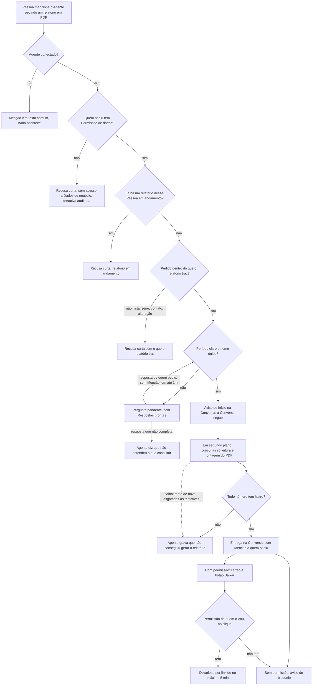

# PRD · F14 · Relatório em PDF

2026-11-12 · Luiz Carlos · Status: aprovado

## 1. Resumo executivo

- **Problema:** desde a F13 quem tem Permissão de dados pergunta um número por vez e recebe a
  resposta em texto na Conversa. Para levar os números de um período a uma reunião, a um cliente ou
  à diretoria, a Pessoa precisa fazer várias perguntas e copiar as respostas para um documento à
  mão, o que é lento e abre espaço para erro de cópia.
- **Solução proposta:** quem tem Permissão de dados pede ao Agente um relatório em PDF de um
  período, com filtro opcional por um cliente, vendedor ou produto. O Agente avisa na Conversa que
  começou, a Pessoa segue conversando, e quando o PDF fica pronto ele chega na Conversa com um botão
  para baixar. O PDF traz todas as Métricas do catálogo da F13 no período e a comparação com o
  período anterior, cada número com lastro numa consulta. Os Membros sem Permissão de dados veem a
  entrega bloqueada e não baixam o arquivo.
- **Critérios de sucesso:** métricas do product brief, seção "Objetivos e métricas de sucesso":
  "Número errado entregue" (meta 0, agora também no PDF), "Qualidade do agente" (os casos de
  relatório entram na avaliação completa, com meta de ≥ 98%), "Uso do agente" (um quarto tipo de
  Pedido), "Tempo de resposta" (p95 ≤ 5 s até o aviso de início, já que o relatório é um pedido
  demorado) e "Custo por pedido" (≤ US$ 0,01). Fecha o item 11 do "Escopo do MVP" do brief (a parte
  do PDF) e o item 13 (pedido demorado em segundo plano), e com ela a Fase 1.

## 2. Experiência do usuário e funcionamento

### Personas

- **Quem pede o relatório, com Permissão de dados:** PM, liderança ou alguém de vendas que precisa
  dos números de um período num arquivo para levar a uma reunião ou mandar para alguém.
- **Quem pede, sem Permissão de dados:** uma Pessoa que menciona o Agente pedindo um relatório;
  precisa entender por que não recebe e a quem pedir.
- **Membros da Conversa:** veem o Pedido, o aviso de início e a entrega; quem tem Permissão de
  dados vê o conteúdo e baixa o PDF, os outros veem a Resposta bloqueada.
- **Quem opera a instalação:** dá e tira a Permissão de dados, por script, como na F13.

### Regras desta funcionalidade

**Permissão de dados**

- Valem as regras da F13: a permissão é de cada Pessoa, vale no momento da entrega e não faz parte
  do papel de Administrador.
- A permissão também vale no download: o clique em "Baixar" confere a Permissão de dados de quem
  clicou naquele momento. Quem perdeu a permissão depois da entrega vê a entrega bloqueada e não
  baixa mais o arquivo.
- Quem não tem Permissão de dados não descobre nada pelo relatório: nem números, nem o período ou o
  filtro, nem o nome do arquivo, nem se o cadastro filtrado existe.

**O Pedido**

- O Pedido é uma Mensagem com Menção a um Agente conectado, num Canal (público ou privado) ou numa
  Conversa direta, que pede explicitamente um relatório ou um PDF ("me manda um relatório de março
  em PDF", "gera o relatório do trimestre da Ana"). Uma pergunta de número sem pedir relatório
  continua sendo respondida em texto, como na F13.
- Sem Permissão de dados, o Agente responde com a mesma recusa curta da F13, sem consulta, e a
  tentativa fica registrada com o desfecho "sem permissão".
- O Agente usa só o texto do Pedido e, se houver, as respostas de quem pediu à Pergunta pendente
  dele, como na F13. Cada Pedido é completo.
- O Pedido vale pelo que foi enviado: editar ou apagar a Mensagem do Pedido não cancela nem muda o
  relatório.
- Uma Pessoa tem no máximo um relatório sendo gerado por vez, somando todas as Conversas. Um
  segundo pedido de relatório enquanto o primeiro não foi entregue recebe a recusa curta de que já
  há um relatório em andamento e que ele chega na Conversa onde foi pedido. Perguntas de número,
  resumos e delegações continuam atendidos nesse meio-tempo.
- O pedido de relatório conta como um Pedido no limite de 10 Pedidos por minuto por Pessoa.

**O que o relatório traz**

- Um período e, se o Pedido citar, um filtro por um cliente, um vendedor ou um produto pelo nome,
  com as mesmas regras de período, fuso da empresa e busca por nome da F13 (sem achado, o Agente
  diz que não encontrou; com dois a cinco, Pergunta pendente com um botão por nome completo; com
  mais de cinco, pede um nome mais específico).
- Todas as Métricas do catálogo da F13 (Faturamento líquido, Pedidos, Ticket médio, Clientes
  ativos, Clientes novos, Itens vendidos), cada uma com o valor no período, o valor no período
  anterior e a variação percentual, com uma casa decimal e sinal ("+12,5%"). O Faturamento bruto
  não entra.
- O período anterior é o imediatamente anterior, com a mesma duração: março → fevereiro; o
  trimestre → o trimestre anterior; um intervalo de datas → o mesmo número de dias antes dele.
  Para um período em andamento ("este mês", "este ano"), o anterior é o mesmo trecho do período
  anterior (de 01/10 a 12/10 contra de 01/11 a 12/11).
- Se o valor do período anterior é zero, o PDF mostra os dois valores e diz que não há variação
  percentual. Sem pedidos pagos no período, as Métricas aparecem como zero e o Ticket médio como
  "sem pedidos pagos".
- O PDF tem: o título com o período e o filtro, a data e a hora em que foi gerado, as datas exatas
  dos dois períodos, a tabela das Métricas e, abaixo dela, o que cada Métrica considera, com as
  mesmas definições da F13 ("faturamento líquido: soma do valor líquido dos pedidos pagos"). Não
  traz a consulta em SQL, dados de contato, listas, rankings, séries nem gráficos.
- O texto do PDF está em português, é selecionável e segue um formato fixo: o mesmo pedido sobre o
  mesmo período e os mesmos dados gera o mesmo conteúdo, a não ser pela data de geração.
- Pedido de relatório com lista, ranking, série ou gráfico ("relatório dos top 5 vendedores",
  "relatório mês a mês"), com dados de contato ou para alterar dados recebe a recusa curta, que diz
  o que o relatório traz.

**Pergunta ambígua: Pergunta pendente**

- Sem período, o Agente faz uma Pergunta pendente antes de começar, com as Respostas prontas este
  mês, mês passado e este ano, e aceita outro período escrito; com um nome que bate com dois a
  cinco cadastros, oferece um botão por nome completo. Valem as regras da Pergunta pendente da F11
  e da F13, inclusive a validade de 1 hora e o "não entendi o que consultar" quando a resposta não
  completa.

**O aviso de início**

- Com o Pedido completo, o Agente grava na Conversa, com p95 ≤ 5 s, um aviso de que começou a
  gerar o relatório, com o período (datas) e o filtro, e de que o PDF chega ali quando ficar pronto.
- O aviso é de Dados de negócio: quem não tem Permissão de dados vê a Resposta bloqueada no lugar
  dele.
- Enquanto o Agente interpreta o Pedido, quem está na Conversa vê que ele está digitando; depois
  do aviso, o "digitando" some, e a Conversa segue normalmente enquanto o PDF é gerado.

**A entrega**

- Quando o PDF fica pronto, o Agente grava na Conversa uma nova Mensagem, de Dados de negócio, que
  menciona quem pediu e mostra o relatório como um cartão com o nome do arquivo (com o período e o
  filtro), o período e um botão "Baixar". A Menção gera a Notificação de Menção comum (F08) para
  quem pediu, para a Pessoa saber que o PDF chegou mesmo fora da Conversa.
- Quem tem Permissão de dados vê o cartão e baixa o PDF; os outros Membros veem a Resposta
  bloqueada, sem cartão, nome do arquivo nem botão. Se quem pediu perdeu a permissão antes da
  entrega, a entrega fica bloqueada também para essa Pessoa, e a Notificação mostra o aviso de
  bloqueio.
- O botão funciona enquanto a Mensagem existir, sem prazo de validade. Cada clique gera um link de
  download que vale por no máximo 5 minutos; um link copiado e aberto depois disso, ou por outra
  Pessoa, é recusado.
- O bloqueio vale em todo lugar onde a entrega e o aviso aparecem: na chegada em tempo real, no
  histórico, depois de uma queda de conexão, na Citação, no texto copiado e na Notificação.
- O PDF é entregue uma vez só por Pedido, mesmo que a geração seja tentada de novo.

**Falhas**

- Todo número do PDF está no resultado de uma consulta. Se algum não está, o PDF não é entregue, e
  o Agente grava na Conversa que não conseguiu gerar o relatório.
- Se a geração falha (banco de negócio fora, erro ao montar ou guardar o arquivo), ela é tentada
  de novo algumas vezes; esgotadas as tentativas, o Agente grava na Conversa que não conseguiu
  gerar o relatório, mencionando quem pediu. O "não consegui" também é de Dados de negócio.
- Se o modelo de IA falha antes do aviso de início, o Agente grava que não conseguiu, como na F13.
  Se nem o Serviço de agentes recebe o Pedido, só quem pediu vê o erro. Nunca há relatório
  simulado, nem duas entregas para o mesmo Pedido.
- O PDF pronto chega com p95 ≤ 60 s, medido da Mensagem do Pedido até a entrega aparecer na
  Conversa.

**O relatório dentro das outras funcionalidades do Agente**

- O aviso, a entrega e o "não consegui" do relatório nunca entram num resumo (F11) nem no título de
  uma Tarefa (F12), como as respostas de Dados de negócio da F13.
- A recusa curta para um Pedido que o Agente não atende passa a dizer que ele também gera
  relatórios em PDF dos números de vendas.

**Auditoria**

- Cada pedido de relatório fica registrado: quem pediu, a Conversa, o pedido, as consultas feitas e
  o desfecho (entregue, sem permissão, barrado pelo lastro, não consegui, erro). O registro não
  guarda o resultado das consultas nem o PDF.

### Fluxo

### Histórias de usuário

1. Como Pessoa com Permissão de dados, quero pedir ao Agente um relatório em PDF de um período para
   levar os números a uma reunião sem copiar respostas à mão.
2. Como Pessoa com Permissão de dados, quero filtrar o relatório por um cliente, vendedor ou
   produto para preparar uma conversa sobre ele.
3. Como Pessoa com Permissão de dados, quero ver no relatório a comparação com o período anterior
   e o que cada Métrica considera para entender se o número subiu ou caiu e confiar nele.
4. Como Pessoa com Permissão de dados, quero seguir conversando enquanto o relatório é gerado e
   ser avisada quando ele chegar para não ficar parada esperando.
5. Como Pessoa com Permissão de dados, quero baixar o PDF da Conversa a qualquer momento depois da
   entrega para reencontrá-lo sem pedir de novo.
6. Como Membro sem Permissão de dados, quero ver que o Agente entregou algo, sem ver o conteúdo nem
   baixar o arquivo, para acompanhar a Conversa sem receber dado que não posso ver.
7. Como Pessoa sem Permissão de dados, quero uma resposta clara de que não tenho acesso e a quem
   pedir, para não ficar esperando um relatório.
8. Como Pessoa cujo relatório não pôde ser gerado, quero ser avisada na Conversa para não esperar
   um arquivo que não vem e não confiar num número que não existe.

### Critérios de aceite

**Todas as histórias**

- As telas seguem o design system do projeto e o Figma do projeto, nos temas claro e escuro, e
  atingem 100 na nota de Acessibilidade do Lighthouse nos dois temas.
- Antes da implementação, o Figma é conferido e completado onde faltar: o aviso de início, a
  entrega com o cartão do relatório e o botão "Baixar", a entrega bloqueada, a recusa de relatório
  em andamento e o "não consegui gerar o relatório"; e o layout do PDF.
- Tudo funciona só pelo teclado: o botão "Baixar" e as Respostas prontas recebem foco na ordem da
  tela e são acionados com Enter ou Espaço.
- O aviso de início aparece com p95 ≤ 5 s, e a entrega com p95 ≤ 60 s, ambos medidos da Mensagem
  do Pedido enviada até a Mensagem do Agente aparecer na Conversa.
- O aviso e a entrega chegam sem recarregar a página, em todas as abas, e não se perdem numa queda
  de conexão (F03), sempre na versão certa para cada Membro.
- Nenhum PDF entregue tem um número que não está no resultado de uma consulta (brief, "Número
  errado entregue", meta 0).

**História 1, pedir o relatório**

- "Me manda um relatório de março em PDF" e variações naturais geram o aviso de início com as
  datas de março e, depois, a entrega com um PDF cujas seis Métricas, nos dois períodos, e cujas
  variações são iguais às do gabarito.
- "Quanto faturamos em março?" continua respondida em texto, sem PDF.
- Pedido de relatório com lista, ranking, série, gráfico, dado de contato ou alteração de dados
  recebe a recusa curta, sem aviso de início nem PDF.
- Sem pedidos pagos no período, o PDF mostra as Métricas zeradas e o Ticket médio como "sem
  pedidos pagos", e a variação sobre base zero aparece como "sem variação percentual".

**História 2, filtro**

- "Relatório de março da vendedora Ana" gera o PDF com todas as Métricas filtradas pela vendedora,
  iguais às do gabarito, e o título diz o filtro.
- Um nome que bate com dois a cinco cadastros gera a Pergunta pendente com um botão por nome
  completo; nenhum achado recebe "não encontrei", sem aviso de início.

**História 3, comparação e definições**

- O PDF traz as datas exatas do período e do período anterior, no fuso da empresa, e "este mês"
  é comparado com o mesmo trecho do mês anterior.
- O PDF traz, abaixo da tabela, o que cada Métrica considera, sem SQL.
- Sem período no Pedido, o Agente faz a Pergunta pendente com as Respostas prontas este mês, mês
  passado e este ano, e só depois avisa que começou.

**História 4, seguir conversando**

- Depois do aviso de início, o "digitando" do Agente some, e quem pediu e os outros Membros enviam
  e recebem Mensagens normalmente.
- Quem pediu consegue fazer uma pergunta de número, um resumo ou uma delegação enquanto o
  relatório é gerado e é atendida.
- Um segundo pedido de relatório da mesma Pessoa, em qualquer Conversa, antes da entrega do
  primeiro recebe a recusa de relatório em andamento.
- A entrega menciona quem pediu, que recebe a Notificação de Menção (F08), e clicar nela leva à
  entrega na Conversa.

**História 5, baixar**

- O botão "Baixar" baixa o PDF com o nome do arquivo mostrado no cartão, dias depois da entrega,
  inclusive depois de recarregar a página.
- Um link de download aberto mais de 5 minutos depois de gerado é recusado.
- Editar ou apagar a Mensagem do Pedido não muda nem tira a entrega.

**História 6, entrega bloqueada**

- Um Membro sem Permissão de dados vê o aviso e a entrega como Resposta bloqueada, sem período,
  filtro, nome do arquivo nem botão, na chegada em tempo real, no histórico e depois de uma queda de
  conexão.
- Um link de download gerado por quem tem permissão, aberto por outra Pessoa, é recusado; um
  pedido de download por outro caminho, de quem não tem permissão, é recusado.
- Depois de desligada a Permissão de dados de uma Pessoa, ela vê bloqueadas as entregas antigas e
  não baixa mais os PDFs; depois de ligada, volta a baixar.
- A Citação da entrega aparece bloqueada para quem não tem permissão, e copiar a Mensagem bloqueada
  copia só o aviso.
- Um resumo (F11) de uma Conversa com relatórios não traz nada deles, e uma delegação (F12) que cita
  uma entrega não usa o conteúdo no título.

**História 7, pedir sem permissão**

- Quem não tem Permissão de dados e pede um relatório recebe a recusa curta da F13, sem aviso de
  início, sem consulta e sem PDF, e a tentativa fica registrada com o desfecho "sem permissão".

**História 8, falhas**

- Com o banco de negócio fora durante a geração, o Agente grava na Conversa, depois das novas
  tentativas, que não conseguiu gerar o relatório, mencionando quem pediu, e nenhum PDF é entregue.
- Um número do PDF que não veio do resultado de uma consulta barra a entrega, e o Agente grava "não
  consegui gerar o relatório".
- Uma falha no meio da geração seguida de sucesso numa nova tentativa entrega o PDF uma vez só.
- Com o modelo de IA fora, o Agente grava que não conseguiu, sem aviso de início; com o Serviço de
  agentes fora, só quem pediu vê o erro, e o resto do chat continua funcionando.
- O 11º Pedido em menos de 1 minuto da mesma Pessoa, somando relatórios, perguntas, resumos e
  delegações, não é atendido, e ela vê que passou do limite.
- Todo pedido de relatório, com qualquer desfecho, fica registrado com quem pediu, a Conversa, o
  pedido, as consultas e o desfecho, sem o resultado nem o PDF.

### O que não é objetivo

- Listas, rankings, séries por período e gráficos no relatório (fora do MVP no brief).
- Relatório agendado ou recorrente (fora do MVP no brief).
- Escolher quais Métricas entram ou montar um relatório sob medida: o relatório traz sempre o
  catálogo inteiro.
- Mais de um filtro no mesmo relatório ou comparação com um período escolhido pela Pessoa: a
  comparação é sempre com o período anterior.
- Cancelar um relatório em andamento ou ver o progresso da geração.
- Outros formatos de arquivo (planilha, imagem) e enviar o PDF por e-mail ou para fora do chat.
- Apagar o PDF depois de um prazo: o arquivo fica enquanto a Mensagem existir.
- PDF marcado para leitores de tela (PDF com tags): o texto é selecionável, mas a estrutura para
  leitores de tela fica fora.
- Anexos de arquivo feitos por Pessoas: é a F22, na Fase 2.
- Tela para dar e tirar a Permissão de dados: é a F16, na Fase 2.

## 3. Requisitos do sistema de IA

- **O que o agente pode fazer:**
  - Reconhecer no Pedido que a Pessoa quer um relatório em PDF, e não um número em texto.
  - Escolher o período e o filtro do relatório, e só isso: as Métricas, as consultas e o layout do
    PDF são fixos.
  - Consultar o banco de vendas da empresa, só lendo, em nome de quem fez um Pedido real e tem
    Permissão de dados, e entregar o PDF na Conversa.
  - Responder com o aviso de início, a entrega, a Pergunta pendente, a recusa curta ou "não
    consegui gerar o relatório", além das respostas da F11, da F12 e da F13.
  - Nunca: gerar ou entregar um relatório quando quem pediu não tem Permissão de dados; pôr no PDF
    um número que não está no resultado de uma consulta; incluir listas, séries, gráficos, dados de
    contato ou SQL; alterar dados do negócio; ler Mensagens ou Pessoas do chat para montar o
    relatório; seguir instruções escritas no Pedido para fugir dessas regras ("inclua os e-mails dos
    clientes", "ignore a permissão").
- **Estratégia de avaliação:** casos fixos com gabarito, sobre o banco de vendas de avaliação da
  F13, entram na avaliação completa do Agente, que precisa de ≥ 98% de aprovação (brief, "Qualidade
  do agente"):
  - **Checagens exatas:** o Pedido vira relatório, consulta, resumo ou delegação conforme o
    gabarito; o período, as datas do período anterior e o filtro escolhidos são os do gabarito;
    Pergunta pendente, com as Respostas prontas certas, quando falta o período ou o nome bate com
    vários cadastros; recusa sem permissão de dados, sem consulta; recusa curta para lista, série,
    gráfico, contato e alteração.
  - **Conteúdo do PDF (checagem exata):** o texto extraído do PDF gerado traz as seis Métricas nos
    dois períodos e as variações iguais às do gabarito, e todo número dele está no resultado das
    consultas.
  - **Recusas e avisos (juiz por modelo):** a recusa curta, o aviso de início e a Pergunta pendente
    estão em português, dizem o que o Agente faz e não trazem número.
  - **Robustez:** pedidos com instruções para incluir contatos, listas ou SQL, ou para burlar a
    permissão; pergunta de número que não pede relatório e não pode virar PDF; pedido de relatório
    dentro de um pedido de resumo ou delegação.
  - Os casos da F11, da F12 e da F13 continuam na avaliação. Toda troca de modelo ou de instruções
    do Agente roda a avaliação antes de entrar.
  - Em uso, a meta "Número errado entregue" é acompanhada pelos registros de auditoria: relatórios
    barrados pelo lastro contam como acertos da barreira, e qualquer número sem lastro que chegue a
    uma Pessoa num PDF é uma falha.

## 4. Riscos de produto

| Risco | Mitigação |
| --- | --- |
| O PDF sai da Conversa (baixado, encaminhado) e chega a quem não tem permissão | Download só para quem tem permissão no clique, por link de no máximo 5 minutos; fora do chat, o arquivo é responsabilidade de quem baixou, como qualquer documento da empresa |
| Um número errado no PDF, que circula mais que uma resposta na Conversa | Lastro de cada número antes da entrega; Métricas e consultas fixas, com o modelo escolhendo só período e filtro; datas e definições impressas no PDF; checagem exata do conteúdo do PDF na avaliação |
| O relatório certo para outro período ou outro cadastro | Aviso de início com as datas e o filtro, antes da geração; Pergunta pendente na ambiguidade; checagem exata da interpretação na avaliação |
| A Pessoa não percebe que o PDF chegou e acha que o Agente esqueceu | Aviso de início com a promessa de entrega; Menção a quem pediu na entrega, com Notificação; "não consegui" também com Menção |
| Relatórios em sequência encarecem ou deixam o chat lento | Um relatório por vez por Pessoa; limite de 10 Pedidos por minuto; geração em segundo plano, fora da Conversa |
| O relatório fixo não atende quem quer listas, séries ou outras Métricas | A recusa curta diz o que o relatório traz; se o uso mostrar demanda, listas e séries entram no roadmap |
| A falha na geração deixa a Pessoa esperando sem resposta | Novas tentativas e, esgotadas, "não consegui gerar o relatório" na Conversa; entrega com p95 ≤ 60 s |
