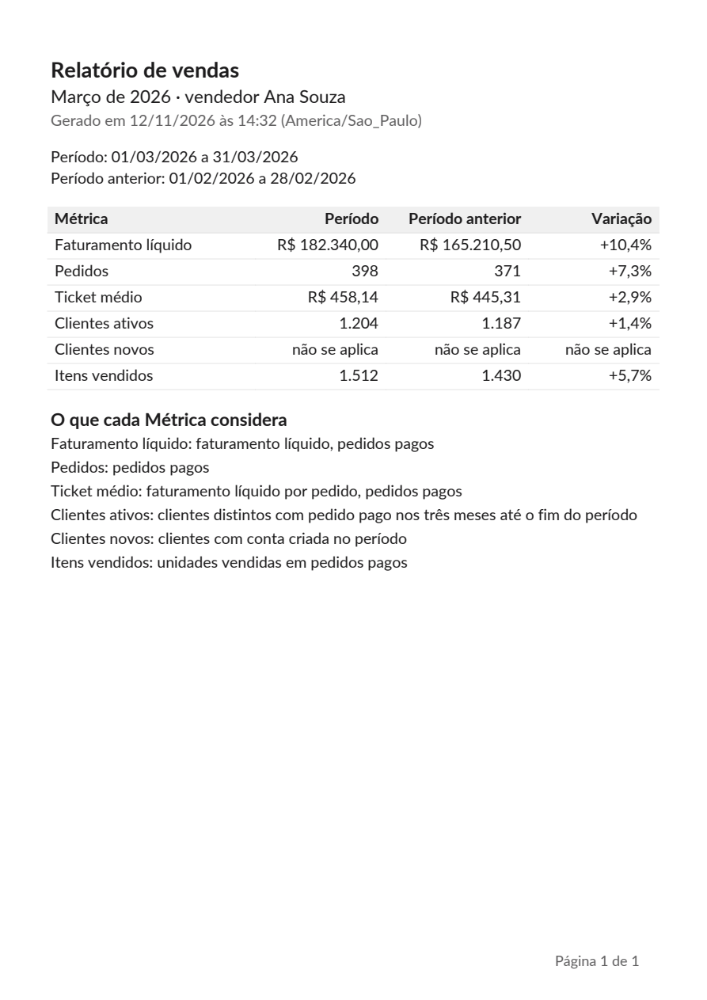

# Validação do PDF da F14-T03

O PDF gerado pelo `build_pdf` (Relatório de março de 2026 com o filtro de vendedor, números de
exemplo) foi renderizado em PNG e comparado com o frame `Relatório / PDF / Março de 2026` (211:65008)
da seção "Relatório em PDF (F14)" do Figma.

Conferido:

- A4 retrato (595 × 842 pt), margens de 40 pt nas laterais e 48 pt no topo;
- "Relatório de vendas" em Lato Bold 18, o período e o filtro em 15, "Gerado em … (America/Sao_Paulo)"
  em 13 com `fg-muted`;
- as datas dos dois períodos em 13;
- a tabela com as colunas Métrica, Período, Período anterior e Variação nas larguras do frame
  (175, 110, 120 e 110), cabeçalho em negrito sobre `surface-inset`, linhas com a borda inferior
  `border-subtle`, valores alinhados à direita;
- "O que cada Métrica considera" em negrito 15 e as seis definições em 13;
- "Página 1 de 1" no rodapé, à direita, em 12 com `fg-muted`.

Diferença aceita: o fpdf2 não tem a Lato Black; o título usa a Lato Bold, a mais forte das duas
embutidas, como o `title/black` mais próximo.
